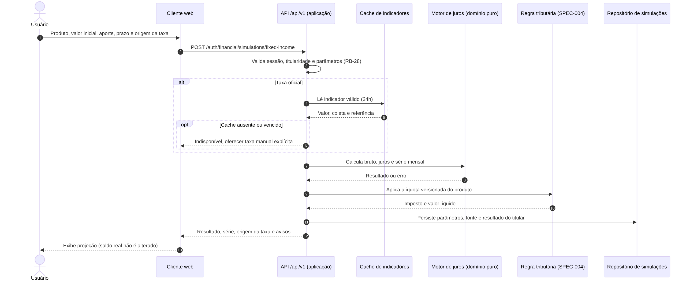
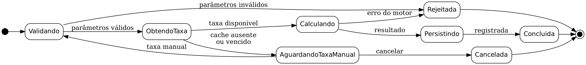

# UC-09 — Simular investimento em renda fixa

**Ator principal:** usuário autenticado. **Objetivo:** obter projeção bruta e, quando a regra tributária estiver definida, líquida para o produto escolhido.
**Origem:** RF-20, RF-22, RF-23; RB-07, RB-10, RB-11, RB-28, RB-29; RNF-01, RNF-04, RNF-07, RNF-09; DA-02, DA-03; ADR-002, ADR-003.
**Pré-condições:** sessão válida; produto e regra de cálculo aprovados. O resultado líquido usa a tabela regressiva interna da SPEC-004 (CDB e Tesouro; poupança isenta), implementada em `backend/app/domain/financeiro.py`; demais produtos seguem OPEN-07.

## Fluxo principal

1. Usuário escolhe produto, valor inicial, aporte mensal, prazo e origem da taxa (oficial ou hipótese manual).
2. Aplicação valida sessão, titularidade e parâmetros conforme RB-28; obtém unidade e periodicidade da taxa.
3. Para taxa oficial, lê cache local e verifica validade de 24h desde a verificação da fonte. Mostra coleta e referência econômica separadas. Não faz chamada síncrona à fonte.
4. Motor puro calcula valor bruto, juros e evolução mensal com aportes ao fim de cada período (UC-08/SPEC-002).
5. Serviço tributário, quando definido para o produto, aplica regra versionada (SPEC-004 planejada). Não apresentar valor líquido inventado.
6. Aplicação associa parâmetros, fontes, hipóteses e resultado à simulação do usuário; se o histórico estiver disponível, persiste por repositório.
7. Exibe valores e série, origem da taxa, aviso de projeção e hipótese tributária. Simulação não altera saldo ou patrimônio real.

## Extensões

### E1 — Parâmetros inválidos (passo 2)

1. Valor inicial/aporte negativo, taxa negativa, prazo não positivo ou campo sem unidade é rejeitado.
2. Exibir o erro correspondente e permitir correção. Não gerar nem persistir resultado.

### E2 — Cache vencido ou ausente (passo 3)

1. Informar que não existe indicador oficial válido; não substituir por zero nem usar dado vencido.
2. Usuário pode informar taxa manual explicitamente como hipótese, retornando ao passo 2, ou cancelar.
3. Se a atualização externa falhou mas o cache ainda é válido, usar cache com aviso e referência; isso não transforma a simulação em consulta direta à API.

## Pós-condições e critérios

- Com sucesso: resultado rastreável disponível ao titular; dados reais não alterados.
- Com erro: ausência de novo resultado persistido e preservação dos dados anteriores.
- Dado taxa anual manual de 12%, inicial de R$ 1.000,00, aporte zero e 12 meses, quando calcular o bruto, então exibir R$ 1.120,00 conforme precisão definida em OPEN-03, sem considerar IR neste caso de referência.
- Dado cache sem validade, quando pedir taxa oficial, então não calcular com dado vencido; oferecer hipótese manual explicitamente.

## Estados, sequência e EARS

Estados descrevem a execução do fluxo, não impõem coluna de estado no banco. O motor puro apenas retorna resultado ou erro. Persistência é responsabilidade da aplicação.

- IF parâmetros inválidos forem recebidos THEN THE SYSTEM SHALL rejeitar a simulação sem alterar dados reais.
- IF cache oficial estiver ausente ou vencido THEN THE SYSTEM SHALL informar indisponibilidade e exigir escolha explícita para usar taxa manual.
- WHILE a simulação estiver em cálculo THE SYSTEM SHALL preservar o saldo e o patrimônio real do usuário.
- WHEN cálculo e eventual persistência forem confirmados THE SYSTEM SHALL mostrar resultado e hipóteses ao titular.

Fonte [Mermaid](seq-UC-09.mmd) e [SVG](seq-UC-09.svg).

Fonte [Mermaid](estados-UC-09.mmd), [DOT](estados-UC-09.dot) e [SVG](estados-UC-09.svg).
