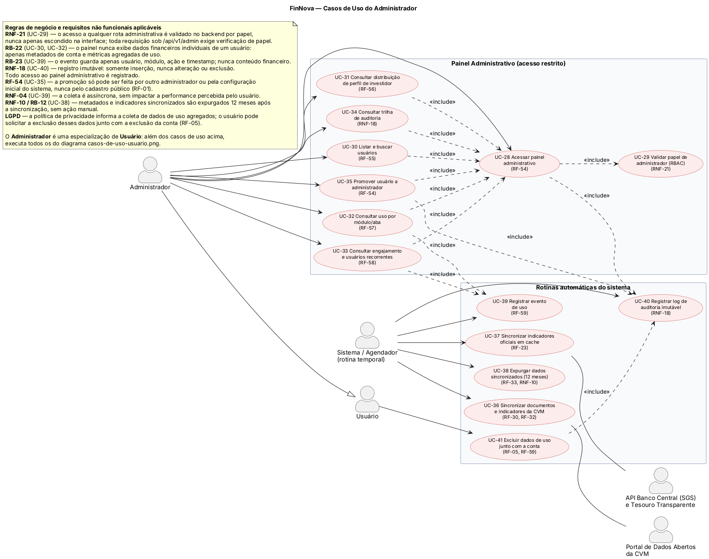

# FinNova — Casos de Uso do Administrador

## Visão geral

Este documento descreve os casos de uso relacionados à administração da plataforma FinNova, incluindo o painel administrativo de acesso restrito e as rotinas automáticas de manutenção e sincronização de dados.

## Diagrama

## Atores

- **Administrador**: acessa o painel administrativo para consultar usuários, permissões, uso do sistema e trilhas de auditoria.
- **Usuário**: pode solicitar a exclusão dos próprios dados de uso junto com a conta.
- **Sistema / Agendador**: executa rotinas automáticas em períodos definidos.
- **API Banco Central (SGS) e Tesouro Transparente**: fornece indicadores oficiais para sincronização.
- **Portal de Dados Abertos da CVM**: fornece documentos e indicadores públicos da CVM.

## Casos de uso

### Painel Administrativo (acesso restrito)

| ID | Caso de uso | Requisito relacionado | Descrição |
| --- | --- | --- | --- |
| UC-28 | Acessar painel administrativo | RF-54 | Permite ao administrador entrar no painel, após validação do papel administrativo. |
| UC-29 | Validar papel de administrador (RBAC) | RB-21, RNF-21 | Valida no backend se o usuário possui o papel necessário para acessar cada rota administrativa. |
| UC-30 | Listar e buscar usuários | RF-55 | Permite consultar e localizar usuários cadastrados. |
| UC-31 | Consultar distribuição de perfil de investidor | RF-56 | Exibe a distribuição dos perfis de investidor dos usuários. |
| UC-32 | Consultar uso por módulo/aba | RF-57 | Exibe métricas agregadas de utilização por módulo ou aba. |
| UC-33 | Consultar engajamento e usuários recorrentes | RF-58 | Permite acompanhar o engajamento e identificar usuários recorrentes. |
| UC-34 | Consultar trilha de auditoria | RNF-18 | Permite consultar os registros imutáveis de ações administrativas e eventos de uso. |
| UC-35 | Promover usuário a administrador | RF-54 | Permite promover um usuário a administrador, respeitando as regras de autorização. |

### Rotinas automáticas do sistema

| ID | Caso de uso | Requisito relacionado | Ator ou integração | Descrição |
| --- | --- | --- | --- | --- |
| UC-36 | Sincronizar documentos e indicadores da CVM | RF-30, RF-32 | Sistema / Agendador; Portal de Dados Abertos da CVM | Obtém e atualiza documentos e indicadores disponibilizados pela CVM. |
| UC-37 | Sincronizar indicadores oficiais em cache | RF-23 | Sistema / Agendador; API Banco Central e Tesouro Transparente | Consulta indicadores oficiais e mantém os dados disponíveis em cache. |
| UC-38 | Expurgar dados sincronizados (12 meses) | RF-33, RNF-10 | Sistema / Agendador | Remove dados sincronizados com mais de 12 meses, sem ação manual. |
| UC-39 | Registrar evento de uso | RF-59 | Sistema / Agendador | Registra o usuário, o módulo, a ação e o timestamp, sem armazenar conteúdo financeiro. |
| UC-40 | Registrar log de auditoria imutável | RNF-18, RB-19 | Sistema | Registra acessos e ações administrativas sem permitir alteração ou exclusão. |
| UC-41 | Excluir dados de uso junto com a conta | RF-05, RF-59 | Usuário | Exclui os dados de uso agregados quando o usuário solicita a exclusão da conta. |

## Relações entre os casos de uso

- **Acessar painel administrativo** inclui **Validar papel de administrador (RBAC)**.
- As consultas do painel administrativo incluem **Acessar painel administrativo**.
- **Acessar painel administrativo**, **Listar e buscar usuários**, **Consultar uso por módulo/aba**, **Consultar distribuição de perfil de investidor**, **Consultar engajamento e usuários recorrentes** e **Consultar trilha de auditoria** incluem **Registrar log de auditoria imutável**, quando aplicável.
- **Registrar evento de uso** é utilizado pelas rotinas do sistema e pelas ações que precisam gerar métricas de uso.
- **Excluir dados de uso junto com a conta** inclui **Registrar evento de uso**.
- **Sincronizar documentos e indicadores da CVM** e **Sincronizar indicadores oficiais em cache** podem ser executados pelo **Sistema / Agendador** e dependem das respectivas fontes externas.

## Regras de negócio e requisitos não funcionais

- **RB-21 / RNF-21 — Validar papel:** o acesso a qualquer rota administrativa é validado no backend por papel. A interface não é considerada mecanismo de segurança; toda rota `/api/v1/admin/*` exige verificação de papel.
- **RB-22 — Listar usuários e consultar uso:** o painel não exibe dados financeiros individuais. São permitidos apenas metadados de conta e métricas agregadas de uso.
- **RB-23 — Registrar evento de uso:** o evento armazena somente usuário, módulo, ação e timestamp; não armazena conteúdo financeiro.
- **RB-19 / RNF-18 — Log de auditoria:** o registro é imutável, permitindo somente inserção, sem alteração ou exclusão. Todo acesso ao painel administrativo deve ser registrado.
- **RF-54 — Promover administrador:** a promoção só pode ser realizada por outro administrador ou pela configuração inicial do sistema, nunca pelo cadastro público.
- **RNF-04 — Registrar evento de uso:** a coleta é assíncrona e não deve impactar a performance percebida pelo usuário.
- **RNF-10 / RB-12 — Expurgar dados:** metadados e indicadores sincronizados são removidos 12 meses após a sincronização, sem ação manual.
- **LGPD:** a política de privacidade informa a coleta de dados de uso agregados. O usuário pode solicitar a exclusão desses dados junto com a exclusão da conta, conforme o **RF-05**.

## Generalização

O **Administrador** é uma especialização do **Usuário**. Portanto, além dos casos de uso administrativos descritos neste documento, o administrador também pode executar os casos de uso disponíveis para um usuário comum.
