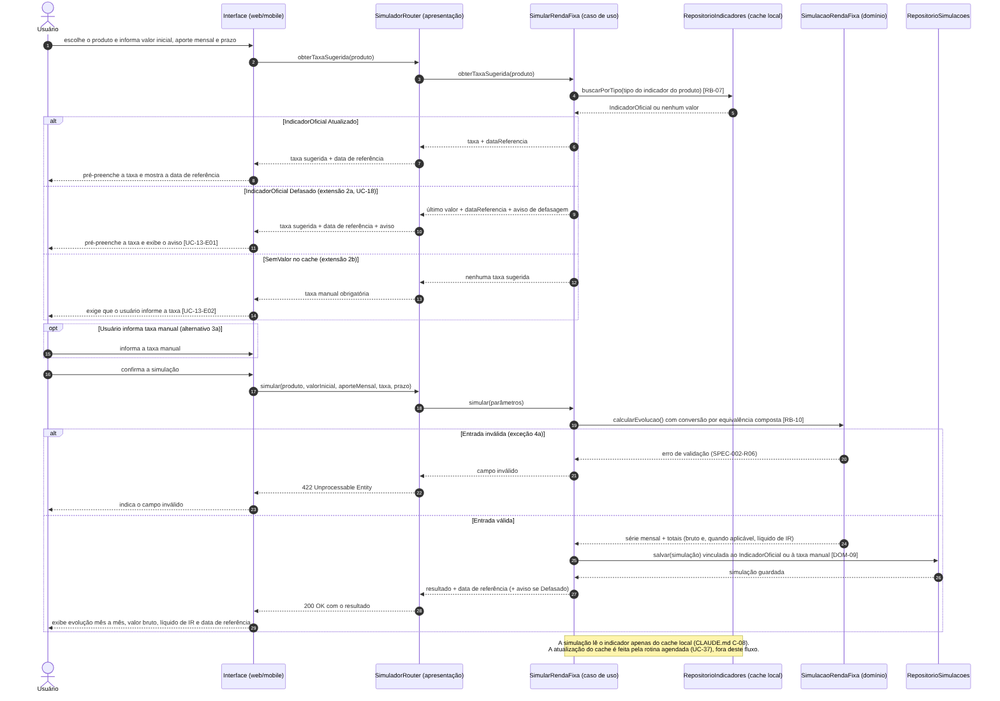
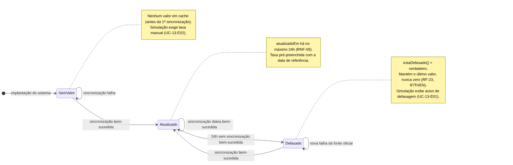

# FinNova — Casos de Uso Detalhados (Fluxo Principal do MVP)

- **Status:** rascunho
- **Última atualização:** 2026-10-18 (Semana 4: campo Objetivo, separação entre fluxos alternativos e exceções, e UC-13 modelado com diagramas)

Descrição textual, com fluxos e exceções, dos casos de uso que compõem o fluxo principal do MVP: o usuário se cadastra, entra na plataforma, registra uma despesa e simula um investimento em renda fixa. Os identificadores seguem as tabelas de `casos-de-uso-usuario.md`.

**Estrutura de cada caso de uso:** nome, ator, objetivo, requisitos e regras (por ID), pré-condições, gatilho, fluxo principal (caminho feliz), fluxos alternativos, exceções e pós-condição. O **UC-13** é o fluxo principal modelado na Semana 4, com diagrama de sequência, diagrama de estados e cláusulas EARS derivadas.

---

## UC-01 — Cadastrar-se

| Item | Descrição |
|---|---|
| Ator principal | Usuário (ainda não cadastrado) |
| Objetivo | Criar uma conta para passar a usar a plataforma. |
| Requisitos | RF-01, RNF-01, RNF-13, RNF-17 |
| Spec | SPEC-001 |
| Pré-condições | Nenhuma. |
| Gatilho | O usuário escolhe criar uma conta. |

**Fluxo principal**

1. O usuário informa nome, e-mail e senha.
2. O sistema valida o formato do e-mail e o tamanho mínimo da senha (8 caracteres).
3. O sistema verifica que o e-mail ainda não está cadastrado.
4. O sistema armazena a senha com hash e salt e cria o usuário.
5. O sistema confirma o cadastro, sem exibir a senha nem o hash.

**Fluxos alternativos**

- Nenhum.

**Exceções**

- **3a. E-mail já cadastrado:** o sistema rejeita o cadastro com mensagem clara e não cria registro (HTTP 409).
- **2a. Dados inválidos:** e-mail malformado ou senha curta; o sistema indica o campo inválido (HTTP 422).
- **Excesso de requisições:** o cliente que ultrapassar o limite do RNF-13 recebe HTTP 429.

**Pós-condição:** existe um `Usuario` com e-mail único e senha protegida por hash.

---

## UC-02 — Autenticar-se

| Item | Descrição |
|---|---|
| Ator principal | Usuário cadastrado |
| Objetivo | Acessar a plataforma com a própria conta e obter uma sessão autenticada. |
| Requisitos | RF-02, RNF-01, RNF-13, RNF-17 |
| Spec | SPEC-001 |
| Pré-condições | O usuário possui cadastro (UC-01). |
| Gatilho | O usuário solicita acesso informando e-mail e senha. |

**Fluxo principal**

1. O usuário informa e-mail e senha.
2. O sistema localiza o usuário pelo e-mail e confere a senha contra o hash.
3. O sistema emite um token de sessão (JWT) com o identificador do usuário e prazo de expiração.
4. O usuário passa a acessar os demais casos de uso autenticado.

**Fluxos alternativos**

- Nenhum.

**Exceções**

- **2a. E-mail inexistente ou senha incorreta:** o sistema responde com a mesma mensagem genérica nos dois casos, sem revelar qual campo falhou (HTTP 401).
- **2b. Tentativas inválidas repetidas:** o acesso da conta é bloqueado por 15 minutos após 5 tentativas inválidas consecutivas para o mesmo e-mail; enquanto durar o bloqueio, o sistema responde HTTP 429 com mensagem genérica (RF-02; SPEC-001-R09 e R10).
- **Excesso de requisições:** HTTP 429 (RNF-13).

**Pós-condição:** o cliente possui um token válido até a expiração ou o logout.

---

## UC-11 — Registrar despesa por categoria

| Item | Descrição |
|---|---|
| Ator principal | Usuário autenticado |
| Objetivo | Registrar uma saída de dinheiro classificada por categoria, mantendo saldo, dashboards e metas atualizados. |
| Requisitos | RF-09, RF-10, RF-11, RF-12, RB-01, RB-02, RNF-03 |
| Spec | a definir |
| Pré-condições | Usuário autenticado (UC-02). |
| Gatilho | O usuário escolhe registrar uma nova despesa. |

**Fluxo principal**

1. O usuário informa valor, categoria e data da despesa.
2. Opcionalmente, o usuário vincula a despesa a uma conta ou a um cartão (RF-12) e a marca como recorrente ou pontual (RF-09).
3. O sistema valida que o valor é maior que zero (RB-01) e que há exatamente uma categoria (RB-02).
4. O sistema persiste a despesa.
5. O sistema recalcula saldo, dashboards e progresso de metas (RF-11) e exibe a despesa na listagem imediatamente.

**Fluxos alternativos**

- **Ponto de extensão — despesa compartilhada:** se houver conta compartilhada ativa, o usuário pode dividir a despesa (UC-10).

**Exceções**

- **3a. Valor menor ou igual a zero:** o sistema rejeita o registro e indica o campo.
- **3b. Categoria ou data ausente:** o sistema rejeita o registro e indica o campo obrigatório.

**Restrição de usabilidade:** o registro deve ser concluído em, no máximo, 3 passos na web e no mobile (RNF-03).

**Pós-condição:** a despesa está registrada e todos os valores derivados foram recalculados.

---

## UC-13 — Simular investimento em renda fixa

| Item | Descrição |
|---|---|
| Ator principal | Usuário autenticado |
| Atores secundários | API Banco Central (SGS) e Tesouro Transparente, de forma indireta, via cache |
| Objetivo | Projetar quanto um investimento em renda fixa renderá ao fim do prazo, usando a taxa oficial vigente do produto. |
| Requisitos | RF-20, RF-22, RF-23, RB-07, RB-10, RNF-04, RNF-09 |
| Regras de negócio aplicadas | **RB-07** — a simulação é indexada ao CDI, à Selic ou ao IPCA conforme o produto (passo 2). **RB-10** — a taxa é convertida entre mês e ano por equivalência composta, nunca por divisão simples (passo 4). |
| Specs | SPEC-002 (motor de cálculo); tributação na SPEC-004 (futura) |
| Inclui | UC-16 (Obter indicador oficial) e UC-17 (Calcular juros compostos) |
| Estendido por | UC-18 (Usar último valor em cache), que estende o UC-16 incluído no passo 2 |
| Pré-condições | Usuário autenticado (UC-02). |
| Gatilho | O usuário abre o simulador de renda fixa. |
| Diagramas | Sequência: [`seq-UC-13.png`](../uml/seq-UC-13.png) (fonte `docs/uml/seq-UC-13.mmd`). Estados do `IndicadorOficial`: [`estados-indicador.png`](../uml/estados-indicador.png) (fonte `docs/uml/estados-indicador.mmd`). |

**Fluxo principal**

1. O usuário escolhe o produto (CDB, Tesouro ou poupança) e informa valor inicial, aporte mensal e prazo.
2. O sistema obtém, no cache local, a taxa do indicador oficial do produto (UC-16, RB-07) e a pré-preenche, com a data de referência.
3. O usuário mantém a taxa sugerida ou informa uma taxa manual.
4. O sistema executa o motor de juros compostos (UC-17), com conversão de taxa por equivalência composta (RB-10).
5. O sistema guarda a simulação com seus parâmetros, vinculada ao `IndicadorOficial` usado ou à taxa manual (DOM-09), para permitir a comparação de cenários (RF-25).
6. O sistema exibe a evolução mês a mês, o valor bruto e, quando aplicável, o valor líquido de IR, junto com a data de referência do indicador.

**Fluxos alternativos**

- **2a. Indicador defasado por falha da fonte oficial (extensão — UC-18):** o sistema usa o último valor conhecido e exibe aviso de defasagem com a data de referência, nunca um valor zerado (RF-23; cláusula UC-13-E01).
- **2b. Nenhum valor do indicador no cache (extensão):** na primeira execução, antes de qualquer sincronização, o sistema não sugere taxa e exige que o usuário informe a taxa manualmente para prosseguir (cláusula UC-13-E02).
- **3a. Taxa manual:** o usuário substitui a taxa sugerida por um valor próprio; a simulação não é vinculada a um `IndicadorOficial` (RF-20, DOM-09).

**Exceções**

- **4a. Entrada inválida** (valor negativo ou prazo igual a zero): o sistema rejeita a simulação e indica o campo (SPEC-002, R06).

**Pós-condição:** a simulação está guardada com seus parâmetros, e o usuário visualiza a projeção, identificada como simulação educativa e não como recomendação.

**Questão em aberto (resolvida na Semana 4):** como o sistema deve se comportar na primeira execução, antes de qualquer sincronização do indicador (bloquear a simulação ou exigir taxa manual)? **Decisão:** exigir taxa manual, no mesmo padrão de alternativa manual do RF-24 (extensão 2b, cláusula UC-13-E02).

### Diagrama de sequência

Os blocos `alt` modelam as extensões 2a e 2b (estado do indicador) e a exceção 4a; o bloco `opt` modela o fluxo alternativo 3a.

### Diagrama de estados do `IndicadorOficial`

| Estado | Condição | Efeito no UC-13 |
|---|---|---|
| SemValor | Nenhum valor em cache (antes da primeira sincronização). | Extensão 2b: taxa manual obrigatória (UC-13-E02). |
| Atualizado | Última sincronização bem-sucedida há no máximo 24h (RNF-09). | Fluxo principal: taxa pré-preenchida com a data de referência. |
| Defasado | Mais de 24h sem sincronização bem-sucedida; `estaDefasado()` verdadeiro. | Extensão 2a: último valor com aviso de defasagem (UC-13-E01). |

### Cláusulas EARS do UC-13

Cláusulas derivadas dos estados e das exceções. As novas (E01 e E02) também constam do RF-23 em `requisitos.md` e viram `SPEC-NNN-Rxx` quando a spec da simulação de renda fixa for escrita.

| ID | Tipo EARS | Cláusula | Origem |
|---|---|---|---|
| UC-13-E01 | State-driven | WHILE o `IndicadorOficial` do produto estiver Defasado THE SYSTEM SHALL exibir, junto à taxa sugerida e ao resultado da simulação, aviso de defasagem com a data de referência. | Estado Defasado; RF-23, RNF-09 |
| UC-13-E02 | Unwanted behavior | IF não houver valor do `IndicadorOficial` do produto no cache THEN THE SYSTEM SHALL exigir que o usuário informe a taxa manualmente antes de executar a simulação. | Estado SemValor; extensão 2b; RF-20, RF-23 |
| RF-23 (IF/THEN) | Unwanted behavior | IF a API oficial estiver indisponível ou retornar erro na atualização THEN THE SYSTEM SHALL usar o último valor em cache e exibir aviso visual de defasagem — nunca um valor zerado ou inventado. | Transição Defasado → Defasado; extensão 2a |
| SPEC-002-R06 | Unwanted behavior | IF `valor_inicial`, `aporte_mensal` ou `taxa_juros` for negativo, ou `periodo` for menor ou igual a zero, THEN THE SYSTEM SHALL lançar `ValueError` sem executar o cálculo. | Exceção 4a |
| DOM-09 | Event-driven | WHEN uma simulação de renda fixa for criada sem taxa manual THE SYSTEM SHALL associá-la ao `IndicadorOficial` correspondente ao produto. | Passo 5; alternativo 3a |

### Rastreabilidade: regra → diagrama → teste → evidência

| Regra | Passo do UC-13 | Elemento no diagrama | Cláusula que vira teste | Evidência no GitHub |
|---|---|---|---|---|
| RB-07 — indexação conforme o produto | 2 | Sequência: `buscarPorTipo(...) [RB-07]` | DOM-09 (teste na spec do RF-20, a criar) | [#18](https://github.com/EricToshioGoya/Finance-management/issues/18) (RF-20) |
| RB-10 — equivalência composta | 4 | Sequência: `calcularEvolucao() [RB-10]` | SPEC-002-R02 (unitário — Cenário 1) | [#20](https://github.com/EricToshioGoya/Finance-management/issues/20) (RF-22) |
| RF-23 / RNF-09 — indicador defasado | 2a | Sequência: `alt` Defasado; Estados: Atualizado → Defasado | UC-13-E01 (spec a criar) | [#21](https://github.com/EricToshioGoya/Finance-management/issues/21) (RF-23) |
| RF-23 — cache sem valor | 2b | Sequência: `alt` SemValor; Estados: SemValor | UC-13-E02 (spec a criar) | [#21](https://github.com/EricToshioGoya/Finance-management/issues/21) (RF-23) |
| RF-22 — entrada inválida | 4a | Sequência: `alt` Entrada inválida | SPEC-002-R06 (unitário — Cenário 3) | [#20](https://github.com/EricToshioGoya/Finance-management/issues/20) (RF-22) |

Artefatos desta modelagem: caso de uso ([#29](https://github.com/EricToshioGoya/Finance-management/issues/29)), diagrama de sequência ([#30](https://github.com/EricToshioGoya/Finance-management/issues/30)) e diagrama de estados ([#31](https://github.com/EricToshioGoya/Finance-management/issues/31)).
