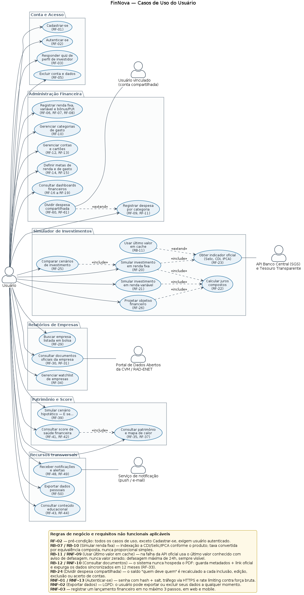

# FinNova — Casos de Uso do Usuário

## Visão geral

Este documento descreve os casos de uso disponíveis para o usuário da plataforma FinNova, incluindo o gerenciamento da conta, a administração financeira pessoal, as simulações de investimentos, os relatórios de empresas, o acompanhamento do patrimônio e os recursos transversais.

## Diagrama

## Atores

- **Usuário**: utiliza a plataforma para administrar suas finanças, consultar informações e realizar simulações.
- **Usuário vinculado (conta compartilhada)**: papel assumido por um usuário cadastrado que participa de uma associação de conta compartilhada para divisão de despesas.
- **API Banco Central (SGS) e Tesouro Transparente**: fornece indicadores oficiais para as simulações.
- **Portal de Dados Abertos da CVM / RAD-ENET**: fornece dados e documentos oficiais de empresas.
- **Serviço de notificação (push / e-mail)**: entrega notificações e alertas ao usuário.

## Casos de uso

### Conta e Acesso

| Caso de uso | Requisito relacionado | Descrição |
| --- | --- | --- |
| Cadastrar-se | RF-01 | Permite criar uma conta na plataforma. |
| Autenticar-se | RF-02 | Permite acessar a plataforma com uma conta cadastrada. |
| Responder quiz de perfil de investidor | RF-03 | Coleta informações para identificar o perfil de investidor do usuário. |
| Excluir conta e dados | RF-05 | Permite solicitar a exclusão da conta e dos dados associados. |

### Administração Financeira

| Caso de uso | Requisito relacionado | Descrição |
| --- | --- | --- |
| Registrar renda fixa, variável e bônus/PLR | RF-06, RF-07, RF-08 | Permite registrar diferentes fontes e tipos de renda. |
| Gerenciar categorias de gasto | RF-10 | Permite criar, editar e organizar categorias de despesas. |
| Gerenciar contas e cartões | RF-12, RF-13 | Permite cadastrar e administrar contas e cartões financeiros. |
| Definir metas de renda e de gasto | RF-14, RF-15 | Permite definir objetivos para receitas e despesas. |
| Consultar dashboards financeiros | RF-16 a RF-19 | Exibe uma visão consolidada da situação financeira do usuário. |
| Dividir despesa compartilhada | RF-60, RF-61 | Permite dividir uma despesa com um usuário vinculado à conta compartilhada. |
| Registrar despesa por categoria | RF-09, RF-11 | Registra uma despesa e associa a ela uma categoria. |

### Simulador de Investimentos

| Caso de uso | Requisito relacionado | Ator ou integração | Descrição |
| --- | --- | --- | --- |
| Comparar cenários de investimento | RF-25 | Usuário | Permite comparar os resultados de diferentes cenários de investimento. |
| Simular investimento em renda fixa | RF-20 | Usuário; API Banco Central e Tesouro Transparente | Simula a evolução de um investimento de renda fixa. |
| Simular investimento em renda variável | RF-21 | Usuário; API Banco Central e Tesouro Transparente | Simula cenários de investimento em renda variável. |
| Projetar objetivo financeiro | RF-26 | Usuário | Permite projetar a evolução necessária para atingir um objetivo financeiro. |
| Obter indicador oficial (Selic, CDI, IPCA) | RF-23 | API Banco Central e Tesouro Transparente | Obtém os indicadores oficiais usados nas simulações. |
| Calcular juros compostos | RF-22 | Usuário | Calcula a evolução dos valores aplicados com base em juros compostos. |
| Consultar indicador em cache | RF-23, RB-11 | Serviço interno | Lê cache válido; não consulta a API oficial durante a simulação. |

### Relatórios de Empresas

| Caso de uso | Requisito relacionado | Ator ou integração | Descrição |
| --- | --- | --- | --- |
| Buscar empresa listada em bolsa | RF-29 | Usuário | Permite localizar uma empresa listada na bolsa de valores. |
| Consultar documentos oficiais da empresa | RF-30, RF-31 | Portal de Dados Abertos da CVM / RAD-ENET | Permite consultar documentos oficiais e acessar seus links de origem. |
| Gerenciar watchlist de empresas | RF-34 | Usuário | Permite acompanhar uma lista personalizada de empresas. |

### Patrimônio e Score

| Caso de uso | Requisito relacionado | Descrição |
| --- | --- | --- |
| Simular cenário hipotético ("e se...") | RF-39 | Permite avaliar cenários hipotéticos para o patrimônio e a vida financeira. |
| Consultar score de saúde financeira | RF-41, RF-42 | Exibe uma avaliação consolidada da saúde financeira do usuário. |
| Consultar patrimônio e mapa de calor | RF-35, RF-37 | Exibe o patrimônio do usuário e sua distribuição em um mapa de calor. |

### Recursos Transversais

| Caso de uso | Requisito relacionado | Ator ou integração | Descrição |
| --- | --- | --- | --- |
| Receber notificações e alertas | RF-48, RF-49 | Serviço de notificação (push / e-mail) | Entrega notificações e alertas relevantes ao usuário. |
| Exportar dados pessoais | RF-50 | Usuário | Permite exportar os dados pessoais mantidos pela plataforma. |
| Consultar conteúdo educacional | RF-43, RF-44 | Usuário | Permite acessar conteúdos de educação financeira. |

## Relações entre os casos de uso

- **Dividir despesa compartilhada** estende **Registrar despesa por categoria**.
- **Comparar cenários de investimento** consulta duas ou mais simulações já existentes e compatíveis. Não obriga executar nova simulação de renda fixa (RF-25).
- **Simular investimento em renda fixa** inclui o motor de juros compostos; consulta cache quando a taxa não é manual. **Simular renda variável** usa hipótese informada ou histórica, sem obrigatoriedade de consultar Selic/CDI/IPCA. Relações include representam somente comportamento obrigatório.
- Cache é a origem ordinária da consulta, conforme ADR-003. Fallback de atualização ocorre na rotina de sincronização; não é extensão de uma chamada síncrona à API oficial no cálculo.
- Score pode ler dados de patrimônio, mas sua consulta não obriga abrir o mapa de calor; a dependência é de dados, não de navegação.
- **Consultar documentos oficiais da empresa** depende do **Portal de Dados Abertos da CVM / RAD-ENET**.
- **Receber notificações e alertas** utiliza o **Serviço de notificação (push / e-mail)**.
- Cadastro e autenticação não exigem sessão anterior; os demais casos pessoais exigem usuário autenticado e titularidade verificada (RB-29).

## Regras de negócio e requisitos não funcionais

- **RF-02 — Pré-condição:** cadastro e login são públicos; os demais casos pessoais exigem usuário autenticado e acesso autorizado ao objeto.
- **RB-07 / RB-10 — Simular renda fixa:** a indexação à CDI/Selic/IPCA segue o produto; a taxa convertida por equivalência composta, nunca proporcional simples.
- **RB-11 / RNF-09 — Usar último valor em cache:** na falha de atualização, usa apenas cache verificado há no máximo 24h, mostrando coleta e referência econômica. Cache vencido/ausente impede cálculo oficial; hipótese manual exige ação explícita.
- **RB-12 / RNF-10 — Consultar documentos:** o sistema nunca hospeda o PDF; guarda apenas metadados e o link oficial, e expurga os dados sincronizados em 12 meses, conforme o **RF-33**.
- **RB-24 — Dividir despesa compartilhada:** o saldo de "quem deve a quem" é recalculado a cada inclusão, edição, exclusão ou acerto de contas.
- **RNF-01 / RNF-13 — Autenticação:** as senhas são armazenadas com hash e salt, o tráfego utiliza HTTPS e há rate limiting contra força bruta.
- **RNF-02 — Exportar dados:** em conformidade com a LGPD, o usuário pode exportar ou excluir seus dados a qualquer momento.
- **RNF-03 — Registrar lançamento:** o registro de um lançamento financeiro deve ocorrer em no máximo três passos, tanto na web quanto no mobile.

## Relações de Associação e Papéis

O **Usuário vinculado (conta compartilhada)** representa o papel que qualquer **Usuário** autenticado assume quando estabelece um vínculo através da entidade associativa `ContaCompartilhada` (`RF-60`, `RF-61`). Os demais casos de uso são executados pelo **Usuário** individualmente.

## Identificadores de casos de uso

| ID | Caso | RF |
|---|---|---|
| UC-01 | Cadastrar-se | RF-01 |
| UC-02 | Autenticar-se | RF-02 |
| UC-03 | Responder quiz | RF-03 |
| UC-04 | Excluir conta | RF-05 |
| UC-05 | Registrar receitas | RF-06, RF-07, RF-08 |
| UC-06 | Registrar despesa | RF-09 |
| UC-07 | Gerenciar contas, cartões e categorias | RF-10, RF-12, RF-13 |
| UC-08 | Calcular juros compostos | RF-22 |
| UC-09 | Simular renda fixa | RF-20, RF-22, RF-23 |
| UC-10 | Simular renda variável | RF-21 |
| UC-11 | Comparar simulações existentes | RF-25 |
| UC-12 | Projetar objetivo | RF-26 |
| UC-13 | Consultar empresas/documentos | RF-29, RF-30, RF-31 |
| UC-14 | Consultar patrimônio/score | RF-35, RF-37, RF-41, RF-42 |
| UC-15 | Notificações, conteúdo e exportação | RF-43, RF-44, RF-48, RF-49, RF-50 |
| UC-16 | Dividir despesa compartilhada | RF-60, RF-61 |

O catálogo agrupa capacidades; fluxo implementável é detalhado por UC/Spec. [UC-09 detalhado](UC-09-simular-renda-fixa.md) inclui fluxo principal e duas extensões; [UC-08](UC-08-calcular-juros-compostos.md) delimita o motor puro. Fontes editáveis das vistas: [DOT do usuário](casos-de-uso-usuario.dot) e [SVG](casos-de-uso-usuario.svg).

## Complemento de conta e acesso

O catálogo complementar em [Conta e acesso](conta-acesso-complemento.md) define UC-23 a UC-29 e RF-68 a RF-74. Cadastro, login, solicitação de recuperação e confirmação por token são fluxos públicos; manutenção do perfil e sessões exigem titular autenticado; finanças exigirão e-mail verificado quando RF-69 for implementado. Essa regra substitui generalizações anteriores que exigiam sessão até para autenticar-se. Os diagramas gerais anteriores não representam integralmente essa expansão; o diagrama complementar é a fonte visual deste recorte.

## Manutenção da conta — capacidades planejadas

| ID | Caso de uso | Requisitos |
|---|---|---|
| UC-23 | Editar nome do próprio perfil | RF-68 |
| UC-24 | Confirmar ou trocar e-mail | RF-69 |
| UC-25 | Recuperar senha | RF-70 |
| UC-26 | Alterar senha autenticado | RF-71 |
| UC-27 | Salvar configurações da conta | RF-72 |
| UC-28 | Renovar ou encerrar sessão | RF-73 |

UC-23/27 exigem autenticação e afetam somente o titular. UC-24 recebe token vinculado à finalidade; troca exige reautenticação e só efetiva o novo e-mail após confirmação. UC-25 responde genericamente, valida token e troca senha revogando sessões. UC-26 exige senha atual e novo login após sucesso. UC-28 renova com rotação ou revoga imediatamente; replay encerra a família.

Token inválido/expirado/usado não altera dados. Falha de envio mantém estado pendente; falha transacional não confirma alteração. UC-04 continua responsável pela exclusão de conta (RF-05) e UC-15 pela exportação (RF-50), ambos ainda pendentes; devem exigir reautenticação e impedir acesso de outro titular. Consulte critérios detalhados na baseline e testes planejados na matriz de cobertura.
