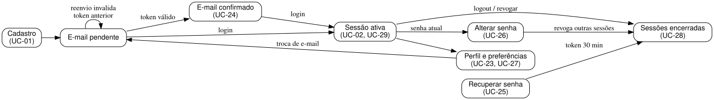

# Conta e acesso — complemento

Estado: RF-68 a RF-73 pendentes; RF-74 implementado inicialmente.

| ID | Caso de uso | Requisito | Precondição |
|---|---|---|---|
| UC-23 | Editar dados do perfil | RF-68 | Titular autenticado |
| UC-24 | Confirmar titularidade do e-mail | RF-69 | Token recebido por e-mail; solicitação pública |
| UC-25 | Recuperar senha esquecida | RF-70 | Token recebido por e-mail; solicitação pública |
| UC-26 | Alterar senha autenticado | RF-71 | Titular autenticado |
| UC-27 | Configurar preferências do usuário | RF-72 | Titular autenticado |
| UC-28 | Consultar e encerrar sessões | RF-73 | Titular autenticado |
| UC-29 | Renovar sessão e realizar logout | RF-74 | Titular autenticado |

## Fluxos e exceções

Editar nome exige sessão; trocar e-mail mantém endereço antigo até confirmar o novo com token e reautenticação. Recuperação usa resposta genérica, token temporário e revogação de todas as sessões ao concluir. Alterar senha exige senha atual. Preferências persistem por usuário; consulta/revogação de sessões nunca revela tokens. Operações rejeitam acesso cruzado. Confirmação e recuperação recusam tokens expirados/reutilizados; reenvio invalida o anterior.

Fonte: [DOT](conta-acesso-complemento.dot). Validades e critérios verificáveis constam nos requisitos; implementação pendente deve testar sucesso, erro e acesso indevido.
