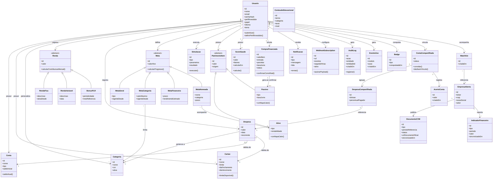

# Modelo de Domínio — FinNova

> Ciclo completo: (1) termos de domínio extraídos dos RF/RB, (2) classes candidatas e responsabilidades, (3) diagrama de classes do domínio V1, (4) rastreabilidade RF/RB → classes (replicada nas Issues).
>
> Referência completa dos requisitos: `/docs/03-requisitos/requisitos.md`. Este documento cobre o **modelo de domínio (conceitual/OO)** — não deve ser confundido com o modelo de dados relacional da seção 4 de `requisitos.md`, que é o modelo de persistência (tabelas). Aqui, `Renda`, `Meta` e `PatrimonioItem` aparecem como hierarquias (generalização/especialização) para expressar comportamento comum entre subtipos — uma decisão de modelagem OO que a tabela relacional não precisa refletir 1:1.

---

## 1. Termos de domínio extraídos das stories/RF

Revisão de `requisitos.md` (RF-01 a RF-67) destacando os substantivos que representam conceitos do negócio:

| Módulo | Termos de domínio identificados |
|---|---|
| Conta e Acesso | Usuário, Perfil de investidor, Papel (usuário/administrador) |
| Administração Financeira | Conta, Cartão, Categoria, Renda fixa, Renda variável, Bônus/PLR, Despesa, Meta geral, Meta por categoria |
| Simulador de Investimentos | Simulação, Meta financeira, Indicador oficial (Selic/CDI/IPCA), Cotação |
| Relatórios de Empresas | Empresa aberta, Documento CVM, Indicador financeiro, Watchlist |
| Patrimônio | Ativo, Passivo, Patrimônio líquido, Meta nomeada |
| Score de Saúde Financeira | Score de saúde, Fator de ponderação, Benchmark |
| Conteúdo Educacional | Conteúdo educacional, Termo |
| Compras Financiadas | Compra financiada, Parcela, Amortização |
| Recursos transversais | Notificação, Exportação, Webhook, Evento de uso, Log de auditoria |
| Painel Administrativo | Administrador, Dashboard de uso |
| Contas Compartilhadas | Conta compartilhada, Despesa compartilhada, Acerto de contas |
| Aposentadoria/Previdência/Impostos | Simulação de aposentadoria, PGBL, VGBL, Estimativa de IR, Informe de rendimentos |
| Gamificação | Badge/Conquista |

---

## 2. Classes candidatas e responsabilidades

| Classe | Responsabilidade principal | RF/RB de origem |
|---|---|---|
| `Usuario` | Representar identidade, papel e preferências; associar a titularidade dos dados pessoais. Autenticação é um serviço de aplicação, não método que acessa banco dentro da entidade | RF-01, RF-02, RF-03, RB-27, RB-29 |
| `Conta` | Representar uma conta bancária/carteira e expor o saldo atual | RF-12 |
| `Cartao` | Controlar limite e ciclo de fatura; calcular limite disponível (RB-04) | RF-12, RF-13 |
| `Categoria` | Classificar despesas em áreas de gasto (padrão ou personalizada) | RF-10 |
| `Renda` (abstrata) | Generalizar o comportamento comum de qualquer entrada de renda; calcular contribuição mensal | RF-06, RF-07, RF-08 |
| `ReceitaRecorrente` / `ReceitaPontual` / `BonusPLR` | Especializações de `Renda`, cada uma com sua regra de cálculo (RB-05, RB-06) | RF-06, RF-07, RF-08 |
| `Despesa` | Representar um gasto, opcionalmente recorrente ou compartilhado | RF-09, RF-11 |
| `Meta` (abstrata) | Generalizar metas do usuário; calcular progresso | RF-14, RF-15 |
| `MetaGeral` / `MetaCategoria` / `MetaFinanceira` / `MetaNomeada` | Especializações de `Meta` por escopo (renda/gasto geral, categoria, projeção de investimento, objetivo nomeado vinculado a um ativo) | RF-14, RF-15, RF-26, RF-40 |
| `Simulacao` | Registrar tipo, parâmetros, hipóteses e resultado da projeção. O motor de cálculo é separado e puro; a aplicação coordena execução e persistência | RF-20 a RF-28, RF-39, RF-62 a RF-64, RB-28 |
| `EmpresaAberta` | Representar uma companhia listada em bolsa | RF-29 |
| `DocumentoCVM` | Guardar metadados de um documento oficial e o link externo (nunca o binário) | RF-30, RF-31, RB-12 |
| `IndicadorFinanceiro` | Guardar um indicador estruturado extraído dos dados abertos da CVM | RF-32 |
| `Watchlist` | Vincular um usuário a empresas de interesse | RF-34 |
| `PatrimonioItem` (abstrata) | Generalizar itens que compõem o patrimônio, com valor e origem (automática/manual) | RF-35 |
| `Ativo` / `Passivo` | Especializações de `PatrimonioItem`; calculam a cor do mapa de calor patrimonial (RB-14) | RF-35, RF-37 |
| `ScoreSaude` | Calcular e manter a nota de saúde financeira do usuário | RF-41, RF-42 |
| `CompraFinanciada` | Simular um financiamento e, ao ser confirmada, gerar um `Passivo` (RB-16) | RF-45 a RF-47 |
| `Notificacao` | Representar e enviar um alerta ao usuário pelo canal habilitado | RF-48, RF-49 |
| `WebhookSubscription` | Configurar e assinar (HMAC) o payload enviado a sistemas externos | RF-53, RB-20 |
| `AuditLog` | Registrar de forma imutável ações sensíveis do usuário/administrador | RF-54, RNF-18, RB-19 |
| `EventoUso` | Registrar eventos de uso agregáveis para os dashboards administrativos | RF-59, RB-22, RB-23 |
| `ConteudoEducacional` | Fornecer verbetes explicativos e ajuda contextual | RF-43, RF-44 |
| `ContaCompartilhada` | Vincular dois usuários e controlar o ciclo de vida do vínculo | RF-60 |
| `DespesaCompartilhada` | Registrar a divisão de uma `Despesa` entre os dois usuários vinculados | RF-61, RB-24 |
| `AcertoConta` | Registrar um pagamento entre os dois usuários que reduz o saldo pendente | RF-61, RB-24 |
| `Badge` | Representar uma conquista obtida pelo usuário | RF-67 |

> **Nota de design:** `Simulacao` concentra vários tipos de cálculo (renda fixa, variável, aposentadoria, IR, stress test); no refinamento para V2, é candidata a adotar o padrão **Strategy** (uma `EstrategiaDeSimulacao` por tipo), evitando um único método `executar()` com múltiplos `if/switch` por `tipo`.

---

## 3. Diagrama de classes do domínio (V1)

Fontes editáveis: [Mermaid](diagrama_dominio.mmd) e [Graphviz DOT](diagrama-de-dominio.dot). Vista em [SVG](diagrama-de-dominio.svg). A imagem foi refeita para o núcleo financeiro; entidades de expansão permanecem nas tabelas abaixo. A vista não pretende colocar todo o catálogo em uma única imagem.

Exemplo de exportação com Graphviz instalado: `dot -Tpng diagrama-de-dominio.dot -o diagrama-de-dominio.png`. Atualizar fontes e imagem juntas.

### Principais relações do diagrama

- `Usuario` é o titular dos dados pessoais. Isso não significa carregar todos os módulos como um único agregado transacional; contas, simulações e outros conceitos mantêm responsabilidades próprias.
- `Renda`, `Meta` e `PatrimonioItem` são classes abstratas com especializações (generalização/herança), reduzindo duplicação de regra entre subtipos.
- `Despesa` pode ser debitada de uma `Conta` ou de um `Cartao`, pertence a uma `Categoria`, e pode ser referenciada por uma `DespesaCompartilhada`.
- `ContaCompartilhada` vincula exatamente 2 `Usuario`, agrupa `DespesaCompartilhada` e registra `AcertoConta` (RF-60/61).
- `CompraFinanciada`, ao ser confirmada como real, gera um `Passivo` (RB-16).
- `EmpresaAberta` publica `DocumentoCVM` e reporta `IndicadorFinanceiro`; `Watchlist` liga `Usuario` a `EmpresaAberta`.

---

## 4. Rastreabilidade RF/RB → Classes do domínio

| Classe | RFs relacionados | RBs relacionadas |
|---|---|---|
| Usuario | RF-01, RF-02, RF-03, RF-04, RF-05 | RB-09, RB-27, RB-29 |
| Conta / Cartao | RF-12, RF-13 | RB-04 |
| Categoria | RF-10 | RB-02 |
| Renda / ReceitaRecorrente / ReceitaPontual / BonusPLR | RF-06, RF-07, RF-08 | RB-01, RB-05, RB-06 |
| Despesa | RF-09, RF-11 | RB-01, RB-02, RB-03 |
| Meta / MetaGeral / MetaCategoria / MetaFinanceira / MetaNomeada | RF-14, RF-15, RF-19, RF-26, RF-40 | RB-18 |
| Simulacao | RF-20 a RF-28, RF-39, RF-62, RF-63, RF-64 | RB-07, RB-08, RB-10, RB-11, RB-17, RB-25, RB-28, RB-29 |
| EmpresaAberta / DocumentoCVM / IndicadorFinanceiro / Watchlist | RF-29 a RF-34 | RB-12 |
| PatrimonioItem / Ativo / Passivo | RF-35, RF-36, RF-37, RF-38 | RB-13, RB-14 |
| ScoreSaude | RF-41, RF-42, RF-66 | RB-15, RB-26 |
| CompraFinanciada | RF-45, RF-46, RF-47 | RB-16 |
| Notificacao | RF-48, RF-49 | — |
| WebhookSubscription | RF-52, RF-53 | RB-20 |
| AuditLog | RF-54 | RB-19, RB-21 |
| EventoUso | RF-55 a RF-59 | RB-22, RB-23 |
| ConteudoEducacional | RF-43, RF-44 | — |
| ContaCompartilhada / DespesaCompartilhada / AcertoConta | RF-60, RF-61 | RB-24 |
| Badge | RF-67 | — |

## 5. Multiplicidades e invariantes em texto

| Relação | Cardinalidade e regra |
|---|---|
| Usuario — Conta/Cartao | Usuário possui 0..N contas/cartões; cada conta/cartão pertence a exatamente 1 usuário |
| Usuario — Renda/Despesa/Simulacao | Usuário possui 0..N registros de cada tipo; cada registro pertence a 1 usuário. Titularidade validada por RB-29 |
| Categoria — Despesa | Categoria classifica 0..N despesas; cada despesa tem 1 categoria (RB-02). Categoria personalizada tem 1 titular; categoria padrão não tem titular individual |
| Despesa — Conta/Cartao | Cada despesa vincula 1 conta ou 1 cartão, nunca ambos. Cada conta/cartão admite 0..N despesas. Compra em cartão afeta fatura, não debita também a conta automaticamente |
| MetaCategoria — Categoria | Cada meta de categoria limita 1 categoria; categoria pode ter 0..N metas ao longo dos períodos |
| MetaNomeada — Ativo | Cada meta nomeada acompanha 1 ativo do mesmo usuário; um ativo pode apoiar 0..N metas. Progresso percentual segue RB-18 |
| PatrimonioItem — Ativo/Passivo | Ativo e Passivo especializam PatrimonioItem. Projeção em Simulacao não cria item real (RB-13) |
| CompraFinanciada — Passivo | Compra apenas simulada gera 0 passivos; ao registrar financiamento real pode gerar 1 passivo, sem operação de dinheiro pelo FinNova (RB-16) |
| ContaCompartilhada — Usuario | Cada vínculo liga exatamente 2 usuários distintos, com aceite; usuário pode ter 0..N vínculos |
| ContaCompartilhada — DespesaCompartilhada/AcertoConta | Cada vínculo registra 0..N divisões/acertos; cada divisão/acerto pertence a 1 vínculo |
| DespesaCompartilhada — Despesa | Divisão referencia 1 despesa; uma despesa tem 0..1 divisão neste modelo de dois usuários |
| EmpresaAberta — DocumentoCVM/IndicadorFinanceiro | Empresa publica 0..N documentos e reporta 0..N indicadores; cada documento/indicador é de 1 empresa. AcertoConta não publica documento CVM |
| Watchlist — Usuario/EmpresaAberta | Cada vínculo referencia 1 usuário e 1 empresa; cada lado admite 0..N vínculos |
| Usuario — Badge | Usuário conquista 0..N badges; cada conquista é de 1 usuário. Badge não agrupa despesas compartilhadas |

## 6. Separação de conceitos

- `ReceitaRecorrente` e `ReceitaPontual` substituem os nomes ambíguos RendaFixa/RendaVariavel do salário. Renda fixa/variável continuam nomes de investimentos simulados.
- `MotorJurosCompostos` recebe parâmetros e devolve `ResultadoCalculo`, conforme SPEC-002. `Simulacao` é o registro rastreável do resultado, não o motor nem uma tabela dentro do domínio.
- `IndicadorMercadoCache` guarda código, fonte, valor, unidade, periodicidade, data de referência e última verificação da fonte (RF-23, RB-11). É distinto de `IndicadorFinanceiro`, que vem da contabilidade de uma EmpresaAberta (RF-32).
- Eventos, auditoria, notificações e webhooks são conceitos de suporte; transmissão, assinatura, ORM e transporte pertencem aos serviços/adaptadores da arquitetura.
- Não foram adicionados estados pendente/pago ao lançamento da baseline: essa mudança seria nova decisão de comportamento. O modelo de estados anexado representa a execução da simulação.

## Complemento de identidade, preferências e persistência

RF-68 a RF-74 ampliam as responsabilidades de `Usuario`: manter nome/e-mail, estado de verificação do endereço e preferências de idioma/tema/canais. Mudança de e-mail mantém um endereço pendente até confirmação; não substitui imediatamente a identidade de acesso. `PreferenciasUsuario` é objeto de valor associado a um titular. A migration 005 persiste o endereço pendente cifrado e a preferência por titular. Estados de e-mail: pendente → verificado; troca mantém endereço anterior até conclusão. A migration 006 acrescenta o token de recuperação com digest, expiração, consumo e invalidação.

Sessões, digests de refresh e tokens temporários de confirmação/recuperação pertencem à infraestrutura de identidade, não são ativos financeiros. Persistência atual: users, auth_sessions, refresh_tokens, auth_rate_buckets e password_reset_tokens. A migration 004 acrescenta instante de criação e índice de sessão por titular; a migration 003 inclui estado de verificação e tokens de confirmação com finalidade, digest, emissão, expiração, uso e invalidação; a 006 adiciona recuperação com validade de 30 minutos; nunca armazena token bruto. Revogação de todas as sessões acompanha recuperação/alteração de senha em transação. As tabelas financeiras do modelo continuam propostas, sem migrations entregues. Diagramas financeiros anteriores permanecem limitados ao seu recorte; estados e atributos de conta deste complemento devem integrar o próximo refinamento visual.

## Complemento de categorias — SPEC-055

As nove categorias padrão são um catálogo determinístico, sem titular e sem alteração global. A migration 007 guarda apenas a visibilidade de cada padrão por titular; assim ocultar `Lazer` não afeta outro usuário nem remove futuras referências históricas. Categorias pessoais têm titular, nome cifrado, chave de busca HMAC composta pelo titular e nome normalizado, cor hexadecimal e estado ativo. O recorte atual não cria despesas: a regra de exatamente uma categoria será consumida pelas Specs de lançamentos, sem permitir remoção de categoria nesta unidade.

## 7. Extensão de conta: proposta de persistência e invariantes

| Conceito | Relações e dados propostos | Rastreabilidade |
|---|---|---|
| Usuario | Nome, e-mail ativo único, e-mail pendente e instante de verificação; papel não editável pelo titular | RF-68, RF-69 |
| PreferenciaUsuario | 0..1 conjunto por usuário, com idioma, tema e notificações; padrões na ausência | RF-72 |
| TokenAcaoConta | 0..N por usuário, digest, finalidade, expiração e consumo; confirmação/recuperação não compartilham token | RF-69, RF-70 |
| Sessão técnica | 0..N por usuário; expiração/revogação e família de refresh no banco | RF-73, RF-71 |

São propostas lógicas para migrations futuras, exceto a sessão técnica já existente. Senha permanece hash em infraestrutura; envio de e-mail é adaptador, não método de entidade com I/O. Consumo de token e alteração de credencial são atômicos. Exportação é filtrada pelo titular; exclusão revoga sessões/tokens e trata dados relacionados conforme OPEN-05. Diagramas históricos em `docs/uml` não representam migrations executadas; o diagrama específico de conta acompanha esta extensão.

### Contrato do motor implementado

SPEC-002 usa `ResultadoCalculo` e `ResultadoMensal` como objetos de valor imutáveis, sem IDs persistidos ou relacionamentos de posse. `ErroCalculo` é erro de domínio por campo/código. São detalhamentos do motor puro já descrito, sem nova entidade persistente ou alteração dos diagramas conceituais de patrimônio. Vocabulário na seção 8.1 dos requisitos e política técnica no ADR-002.

## 8. Entidades adicionadas na implementação de 2026-10-31

As Specs 040, 044 a 052, 061 e 062 foram implementadas com as entidades abaixo. Os termos foram incluídos no glossário (`requisitos.md`, seção 8.1) antes do uso, conforme a regra C-14. Os nomes de tabela são de infraestrutura; o domínio permanece sem I/O (ADR-002).

| Conceito (classe) | Relações e dados | Persistência | Origem |
|---|---|---|---|
| ContaCompartilhada | Dois `Usuario` distintos (convidante e convidado); estado pendente, ativo, recusado, cancelado, expirado ou encerrado; no máximo um ativo por usuário | `shared_links` | SPEC-044, RF-60 |
| DespesaCompartilhada | 1 `Despesa` do pagador ↔ 0..1 compartilhamento em uma `ContaCompartilhada`; percentual do pagador entre 0 e 100 | `shared_expenses` | SPEC-045, RF-61 |
| AcertoContas | 0..N por `ContaCompartilhada`; pagador, recebedor, valor positivo e chave de idempotência | `shared_settlements` | SPEC-045, RF-61 |
| EstimativaIR | 0..N por `Usuario`; regime, competência, resultado, alíquota, imposto, isenção, vencimento do DARF e versão da tabela | `tax_estimates` | SPEC-048, RF-64 |
| Conquista | 0..N por `Usuario`, única por código | `achievements` | SPEC-051, RF-67 |
| EstadoTour | 0..1 por `Usuario` | `onboarding_tours` | SPEC-052, RF-04 |
| Preferência de privacidade | 0..1 por `Usuario` (comparação anônima do score) | `privacy_settings` | SPEC-050, RF-66 |
| ResumoMensal | 0..1 por `Usuario` e competência; status do envio | `monthly_summaries`, `report_settings` | SPEC-040, RF-51 |
| TentativaEntrega e dispositivo push | 0..N por `Usuario`; canal, status e instante; token do dispositivo cifrado | `notification_deliveries`, `push_devices` | SPEC-061, RF-49 |

Cálculos puros dessas Specs (aposentadoria, previdência, IR e calendário do DARF) ficam em `backend/app/domain/expansion.py`, sem dependência de banco ou HTTP.
