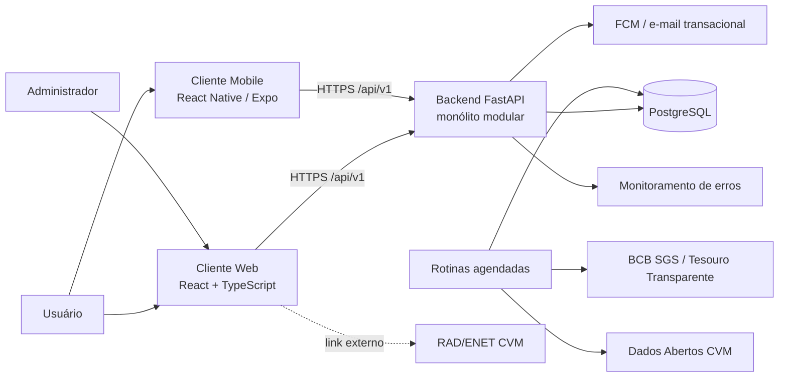

# Arquitetura — FinNova

- **Status:** rascunho
- **Última atualização:** 2026-10-18
- **Decisões registradas:** `docs/07-arquitetura/adrs/` (ADR-001 a ADR-006)

Este é o documento 2 do projeto: visão arquitetural, drivers, decisões técnicas, descrição da arquitetura e justificativas. O documento 1 (requisitos e modelagem) é formado por `docs/01-visao/`, `docs/02-personas/`, `docs/03-requisitos/`, `docs/04-casos-de-uso/` e `docs/modelo-dominio.md`.

**Encadeamento:** visão → requisitos (RF, RNF, RB) → modelo de domínio → casos de uso → **drivers** (seção 1) → **decisões técnicas** (seção 2) → **ADRs** para as decisões difíceis de reverter.

---

## 1. Drivers arquiteturais

Requisitos, restrições e cenários que mais pesam nas escolhas de estrutura, integração, segurança, dados ou tecnologia. Não criam informação nova: selecionam o que mais pesa nos artefatos do documento 1. As specs citam estes identificadores.

| ID | Driver | Origem |
|---|---|---|
| DA-01 | Backend único para web e mobile, modular e de fácil manutenção | RNF-05, RNF-06, RNF-07; restrição da stack (seção 5) |
| DA-02 | Acurácia e testabilidade dos cálculos financeiros | RF-22, RB-10, RNF-07; modelo: `Simulacao.calcularEvolucao()`; UC-17 |
| DA-03 | Simulação rápida e resiliente à indisponibilidade das fontes oficiais | RF-23, RNF-04, RNF-08, RNF-09; modelo: `IndicadorOficial`; UC-13, UC-16, UC-18 |
| DA-04 | Conformidade e baixo custo no armazenamento de dados da CVM | RF-30 a RF-33, RB-12, RNF-10 |
| DA-05 | Segurança de acesso: credenciais, força bruta e autorização por papel | RF-01, RF-02, RNF-01, RNF-13, RNF-18, RNF-21; UC-01, UC-02 |
| DA-06 | Posse e isolamento dos dados financeiros por usuário (LGPD) | RNF-01, RNF-02, RF-05, RF-50; modelo: DOM-01, DOM-02, DOM-03, DOM-08; UC-11, UC-13 |
| DA-07 | Regras de negócio válidas independentemente do canal (web, mobile, rotinas) | RB-01, RB-02, RB-05, RB-10; modelo: DOM-04 a DOM-06; RNF-05 |
| DA-08 | Atualização imediata de saldo e dashboards após cada lançamento | RF-09, RF-11, RB-05, RNF-04; UC-11 |
| DA-09 | Rastreabilidade entre spec e código | Método da disciplina; `CLAUDE.md` C-01 e C-02; RNF-16 |
| DA-10 | Lançamento sem duplicidade em reenvios (clique duplo, nova tentativa de rede, sincronização offline) | RF-06 a RF-09, RF-11, RNF-22, RNF-24; UC-11 |
| DA-11 | Consistência de datas e fusos entre servidores e clientes | RB-05, RB-06, RF-02, RF-33, RNF-09, RNF-25 |

---

## 2. Decisões técnicas

Escolhas concretas em resposta aos drivers. **Critério para ADR: reversibilidade.** Uma decisão que exige migração de dados ou reescrita de camada para ser desfeita ganha ADR; uma decisão barata de desfazer não ganha.

| AD | Driver | Decisão técnica | ADR? |
|---|---|---|---|
| DA-01 | Backend único e modular | Monólito modular em camadas com FastAPI, expondo uma única API REST `/api/v1` para web e mobile; módulos organizados pelas abas da visão. | **ADR-001** — trocar o estilo exige reescrever a base. |
| DA-02 | Cálculos financeiros | Cálculo em funções puras na camada de domínio, com `Decimal` e taxa equivalente composta; testes unitários sem banco nem HTTP. | **ADR-002** — mover a regra de camada reescreve cálculo e testes. |
| DA-03 | Simulação rápida e resiliente | Indicadores lidos apenas do cache local (`IndicadorOficial`), atualizado 1 vez por dia por rotina agendada. A simulação é síncrona (requisição e resposta), sem fila, porque o cálculo roda em memória e cabe no P95 de 3s. Na falha da fonte, usa o último valor com aviso. | **ADR-003** — muda integração e dados. |
| DA-04 | Dados da CVM | Apenas metadados e números estruturados; documento completo acessado por link oficial; expurgo automático após 12 meses. | **ADR-004** — muda armazenamento e política legal. |
| DA-05 | Segurança de acesso | JWT assinado e sem estado no servidor; senha com hash e salt (Bcrypt ou Argon2); bloqueio das tentativas de login para o e-mail por 15 minutos após 5 falhas consecutivas e rate limit de 100 requisições por minuto por cliente; papel verificado no backend, na camada de aplicação, em toda rota administrativa. | **ADR-005** — trocar o mecanismo de sessão afeta todos os clientes e rotas. |
| DA-06 | Posse dos dados | Negar por padrão: toda leitura e alteração de dado financeiro é filtrada pelo `usuario_id` do token dentro da própria consulta do repositório, nunca por verificação posterior. Categorias padrão (sem dono) são somente leitura. Exportação e exclusão completas por usuário. | **ADR-005** — mudar a política depois exige revisar todas as consultas. |
| DA-07 | Regras em qualquer canal | A camada de domínio é o ponto único de validação das regras de negócio, alcançável pela API, pelos clientes e pelas rotinas. Pydantic valida apenas formato; nenhuma regra fica em router, schema ou trigger de banco. | Não — já coberta por ADR-001 e ADR-002. |
| DA-08 | Saldo e dashboards imediatos | Saldo, renda total do mês (RB-05) e dashboards são calculados sob demanda a partir dos lançamentos, sem valores materializados; consultas de agregação apoiadas por índice em (`usuario_id`, `data`). Revisar se ultrapassar o P95 de 3s. | Não — materializar depois é uma otimização local, sem migrar os dados de origem. |
| DA-09 | Rastreabilidade | Um teste por cláusula `SHALL` (SPEC-NNN-Rxx e DOM-xx), nomeado pelo ID; regra apenas no domínio; CI bloqueia o merge com teste vermelho. | Não — convenção de processo, registrada no `CLAUDE.md` e em `docs/10-qualidade/estrategia-de-testes.md`. |
| DA-10 | Lançamento sem duplicidade | Toda criação de lançamento (renda e despesa) aceita uma chave de idempotência gerada pelo cliente (cabeçalho `Idempotency-Key`); o backend guarda a chave por usuário com o resultado e, no reenvio, devolve o mesmo lançamento sem criar outro. A sincronização offline (RNF-22) reaproveita a mesma chave. | Não — a chave é aditiva no contrato da API e pode ser removida sem migrar lançamentos. |
| DA-11 | Datas e fusos | Instantes gravados em UTC (`timestamptz`); datas de calendário guardadas sem hora; mês de competência e exibição calculados em America/Sao_Paulo; relógio injetado no domínio. | **ADR-006** — mudar depois exige migrar todas as datas gravadas. |

---

## 3. Estilo arquitetural e trade-offs

| Estilo | Avaliação para o FinNova |
|---|---|
| **Monolítico modular em camadas (escolhido)** | Atende o backend único (RNF-05) com uma equipe de uma pessoa e um MVP curto; deploy e testes simples; baixa latência entre módulos. Custo: exige disciplina para não acoplar módulos, mitigada pela regra de dependência (seção 6) e pela divisão por abas. |
| Microsserviços | Descartado: alto custo operacional e de distribuição de dados, sem necessidade de escalar módulos de forma independente no MVP (ADR-001). |
| MVC | Não é alternativa ao estilo do backend: é um padrão da camada de apresentação. Os routers FastAPI fazem o papel de controller e os clientes React fazem o de view. |

---

## 4. Visão de contexto



- Os clientes web e mobile consomem a mesma API REST versionada (RNF-05, RNF-17).
- As simulações nunca chamam fontes externas de forma síncrona; leem o cache local alimentado pelas rotinas agendadas (ADR-003).
- O documento completo da CVM é acessado pelo usuário via link oficial, sem passar pelo backend (ADR-004).

---

## 5. Containers e stack tecnológica

| Container | Tecnologia | Responsabilidade |
|---|---|---|
| Cliente web | React + TypeScript + Vite | Interface desktop e responsiva; i18n e tema desde o início (RNF-19, RNF-20) |
| Cliente mobile | React Native (Expo) | Interface mobile; modo offline com sincronização (RNF-22, pós-MVP) |
| Backend | FastAPI + Pydantic + SQLAlchemy/Alembic | API REST `/api/v1`, regras de negócio, autenticação JWT e autorização por papel |
| Rotinas agendadas | Executadas junto ao backend (tecnologia a definir) | Sincronizar indicadores (RF-23), sincronizar CVM (RF-30, RF-32) e expurgar dados com mais de 12 meses (RF-33) |
| Banco de dados | PostgreSQL | Persistência de dados do usuário, cache de indicadores e metadados da CVM |

### Stack e restrições técnicas

Fonte única das escolhas de tecnologia do projeto (antes na visão, seção 3).

| Item | Definição |
|---|---|
| Linguagem (backend) | Python 3.12+ |
| Framework (backend) | FastAPI + Pydantic (validação) + SQLAlchemy/Alembic (ORM/migrations) |
| Cliente web | React + TypeScript + Vite |
| Cliente mobile | React Native (Expo) |
| Banco de dados | PostgreSQL |
| Infra / deploy | Docker + GitHub Actions (CI/CD) + Railway/Render (ou AWS) |
| Autenticação | JWT (access + refresh token) |
| Testes | pytest + coverage (backend), Vitest/Jest (frontend); obrigatórios nas regras de cálculo financeiro |
| Documentação de API | OpenAPI/Swagger (gerado automaticamente pelo FastAPI) |
| Versionamento de API | Prefixo de versão desde o início (ex.: `/api/v1`) |
| Observabilidade | Logging estruturado + monitoramento de erros (ex.: Sentry) |
| Notificações | Firebase Cloud Messaging (push) + serviço de e-mail transacional (ex.: SES/SendGrid) |
| Restrição | Backend único (FastAPI) atendendo web e mobile via API REST compartilhada |

---

## 6. Camadas do backend (ADR-001)

| Camada | Conteúdo | Pode depender de |
|---|---|---|
| Apresentação | Routers FastAPI e schemas Pydantic (DTOs) | Aplicação |
| Aplicação | Casos de uso, orquestração de transações e verificação de permissões | Domínio |
| Domínio | Entidades, regras de negócio e motores de cálculo em Python puro | Nenhuma outra camada |
| Infraestrutura | Repositórios SQLAlchemy, migrations Alembic, clientes de APIs externas e rotinas agendadas | Domínio e Aplicação (implementa as interfaces de repositório) |

**Regra de dependência:** o domínio não importa FastAPI, SQLAlchemy nem faz I/O (ADR-002, `CLAUDE.md` C-05).

### Estrutura de pastas proposta

```
src/finnova/
├── api/              # apresentação: routers e schemas por módulo
├── application/      # casos de uso por módulo
├── domain/           # entidades e motores de cálculo (ex.: juros compostos — SPEC-002)
└── infrastructure/   # banco, clientes externos e rotinas agendadas
tests/
├── unit/             # domínio puro
└── integration/      # API + banco
```

Cada camada é subdividida pelos módulos da visão (conta e acesso, administração financeira, simulador etc.), o que permite adicionar um módulo novo sem alterar os existentes (RNF-06). A estrutura será confirmada no plano da primeira spec implementada.

---

## 7. Fluxos principais

### 7.1 Autenticação (SPEC-001)
Cliente → `POST /api/v1/auth/login` → caso de uso de autenticação → repositório de `Usuario` → verificação do hash e do bloqueio por tentativas → emissão do JWT → cliente envia o token no cabeçalho `Authorization` das requisições seguintes.

### 7.2 Simulação de renda fixa (UC-13, SPEC-002)
Cliente → router do simulador → caso de uso → leitura do indicador no cache local (com data de referência) → motor de juros compostos no domínio → resposta com série mensal, totais e data de referência. Se o cache estiver defasado, a resposta inclui o aviso exigido pelo RF-23.

### 7.3 Registro de despesa e saldo (UC-11)
Cliente (com chave de idempotência) → router de lançamentos → caso de uso → verificação da chave, que devolve o lançamento já criado em caso de reenvio (DA-10) → validação das regras no domínio (DA-07) → gravação filtrada pelo usuário autenticado (DA-06) → saldo e dashboards recalculados sob demanda na próxima consulta (DA-08).

### 7.4 Sincronização e expurgo
Rotina agendada → API SGS / Tesouro Transparente → atualização do cache de indicadores. Rotina agendada → Dados Abertos CVM → gravação de metadados e indicadores → expurgo dos registros com `sincronizado_em` acima de 12 meses (RB-12).

---

## 8. Atributos de qualidade

| Atributo | Pergunta | Resposta da arquitetura |
|---|---|---|
| Segurança | Onde fica a regra de autorização? Quem verifica a permissão? | O papel é verificado no backend, na camada de aplicação, antes de executar o caso de uso (DA-05). A posse do dado é garantida pelo filtro por `usuario_id` dentro da consulta do repositório (DA-06). A interface nunca é mecanismo de segurança. |
| Confiabilidade | O que acontece com reenvio, fonte fora do ar ou fuso diferente? | O reenvio com a mesma chave não duplica o lançamento (DA-10); a fonte fora do ar usa o último valor com aviso (DA-03); instantes em UTC e mês de competência em America/Sao_Paulo (DA-11). O mapa completo das características de qualidade está em `docs/10-qualidade/modelo-de-qualidade.md`. |
| Desempenho | Onde fica o cache? Qual operação domina o custo do fluxo central? | Os indicadores oficiais ficam em cache no banco local (DA-03). Na simulação, o custo dominante é a iteração mês a mês do motor (ex.: 360 meses em 30 anos), feita em memória. Nos dashboards, é a agregação dos lançamentos do mês, apoiada por índice (DA-08). |
| Manutenibilidade | A regra de negócio entra no controller? A persistência vaza para o domínio? | Não. As regras ficam só no domínio (DA-07); repositórios e ORM ficam na infraestrutura (seção 6). |
| Testabilidade | A regra do domínio roda sem banco e sem UI? | Sim: testes unitários puros com pytest (DA-02). Os testes de integração cobrem o filtro de posse e a autorização por papel (DA-05, DA-06). |

---

## 9. Aspectos transversais

| Aspecto | Abordagem | Requisitos |
|---|---|---|
| Autenticação | JWT com access e refresh token | RF-02, SPEC-001, ADR-005 |
| Autorização | Papel (`usuario` ou `administrador`) verificado no backend em toda rota `/api/v1/admin/*`; posse dos dados por filtro de usuário | RNF-21, ADR-005 |
| Versionamento | Prefixo `/api/v1` em todos os endpoints | RNF-17 |
| Documentação da API | OpenAPI/Swagger gerado pelo FastAPI | RNF-15 |
| Observabilidade | Logs estruturados e monitoramento de erros | RNF-12 |
| Auditoria | Registro imutável de ações sensíveis | RNF-18 |
| Segurança | Ver `docs/09-seguranca/seguranca-ssdlc.md` | DA-05, DA-06 |
| Testes | Ver `docs/10-qualidade/estrategia-de-testes.md` | RNF-07, RNF-16 |
| Elementos técnicos fora do domínio | `WebhookSubscription`, `AuditLog`, `EventoUso`, credenciais e preferências de interface ficam na infraestrutura, não no modelo de domínio (`docs/modelo-dominio.md`, seção 7) | RNF-18, RNF-23, RB-23 |

---

## 10. Implantação

Containers Docker; pipeline de CI/CD no GitHub Actions; hospedagem em Railway ou Render (ou AWS), conforme a stack (seção 5).

---

## 11. Decisões pendentes

| Tema | Impacto | Onde será registrado |
|---|---|---|
| Provedor de cotações de ações e FIIs | Bloqueia RF-24 | ADR futuro |
| Tecnologia das rotinas agendadas | RF-23, RF-30, RF-33 | ADR futuro |
| Expiração do JWT e refresh token | SPEC-001, ADR-005 | SPEC-001, OPEN-01 e OPEN-03 |
| Política de arredondamento monetário | SPEC-002 | Decidida em 2026-10-18: SPEC-002-R08 e OPEN-01 (2 casas, `ROUND_HALF_UP`, apenas na saída) |
| Prazo de retenção das chaves de idempotência | DA-10 | Plano da spec do RF-09 |
| Carga do teste de desempenho | RNF-04 | `docs/10-qualidade/estrategia-de-testes.md`, seção 11 |
