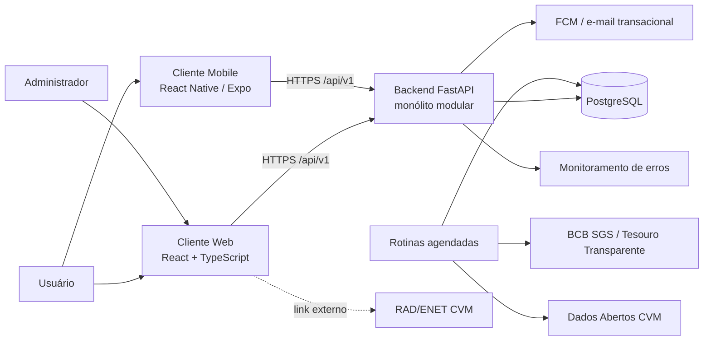

# Arquitetura — FinNova

- **Status:** rascunho
- **Última atualização:** 2026-10-18
- **Decisões registradas:** `docs/07-arquitetura/adrs/` (ADR-001 a ADR-004)

---

## 1. Drivers arquiteturais

Requisitos que mais influenciam a estrutura do sistema. As specs citam estes identificadores.

| ID | Driver | Origem | Decisão |
|---|---|---|---|
| DA-01 | Backend único para web e mobile, modular e de fácil manutenção | RNF-05, RNF-06, RNF-07 | ADR-001 |
| DA-02 | Acurácia e testabilidade dos cálculos financeiros | RF-22, RB-10, RNF-07 | ADR-002 |
| DA-03 | Resiliência à indisponibilidade das fontes oficiais de indicadores | RB-11, RNF-04, RNF-08, RNF-09 | ADR-003 |
| DA-04 | Conformidade e baixo custo no armazenamento de dados da CVM | RB-12, RNF-10 | ADR-004 |
| DA-05 | Segurança e privacidade dos dados financeiros pessoais | RNF-01, RNF-02, RNF-13, RNF-18, RNF-21, RB-19, RB-21 | `docs/09-seguranca/seguranca-ssdlc.md` |

---

## 2. Visão de contexto



- Os clientes web e mobile consomem a mesma API REST versionada (RNF-05, RNF-17).
- As simulações nunca chamam fontes externas de forma síncrona; leem o cache local alimentado pelas rotinas agendadas (ADR-003).
- O documento completo da CVM é acessado pelo usuário via link oficial, sem passar pelo backend (ADR-004).

---

## 3. Containers

| Container | Tecnologia | Responsabilidade |
|---|---|---|
| Cliente web | React + TypeScript + Vite | Interface desktop e responsiva; i18n e tema desde o início (RNF-19, RNF-20) |
| Cliente mobile | React Native (Expo) | Interface mobile; modo offline com sincronização (RNF-22, pós-MVP) |
| Backend | FastAPI + Pydantic + SQLAlchemy/Alembic | API REST `/api/v1`, regras de negócio, autenticação JWT e autorização por papel |
| Rotinas agendadas | Executadas junto ao backend (tecnologia a definir) | Sincronizar indicadores (RF-23), sincronizar CVM (RF-30, RF-32) e expurgar dados com mais de 12 meses (RF-33) |
| Banco de dados | PostgreSQL | Persistência de dados do usuário, cache de indicadores e metadados da CVM |

---

## 4. Camadas do backend (ADR-001)

| Camada | Conteúdo | Pode depender de |
|---|---|---|
| Apresentação | Routers FastAPI e schemas Pydantic (DTOs) | Aplicação |
| Aplicação | Casos de uso, orquestração de transações e verificação de permissões | Domínio |
| Domínio | Entidades, regras de negócio e motores de cálculo em Python puro | Nenhuma outra camada |
| Infraestrutura | Repositórios SQLAlchemy, migrations Alembic, clientes de APIs externas e rotinas agendadas | Domínio e Aplicação (implementa as interfaces de repositório) |

**Regra de dependência:** o domínio não importa FastAPI, SQLAlchemy nem faz I/O (ADR-002, `CLAUDE.md` C-05).

### Estrutura de pastas proposta

```
src/finnova/
├── api/              # apresentação: routers e schemas por módulo
├── application/      # casos de uso por módulo
├── domain/           # entidades e motores de cálculo (ex.: juros compostos — SPEC-002)
└── infrastructure/   # banco, clientes externos e rotinas agendadas
tests/
├── unit/             # domínio puro
└── integration/      # API + banco
```

Cada camada é subdividida pelos módulos da visão (conta e acesso, administração financeira, simulador etc.), o que permite adicionar um módulo novo sem alterar os existentes (RNF-06). A estrutura será confirmada no plano da primeira spec implementada.

---

## 5. Fluxos principais

### 5.1 Autenticação (SPEC-001)
Cliente → `POST /api/v1/auth/login` → caso de uso de autenticação → repositório de `Usuario` → verificação do hash → emissão do JWT → cliente envia o token no cabeçalho `Authorization` das requisições seguintes.

### 5.2 Simulação de renda fixa (UC-13, SPEC-002)
Cliente → router do simulador → caso de uso → leitura do indicador no cache local (com data de referência) → motor de juros compostos no domínio → resposta com série mensal, totais e data de referência. Se o cache estiver defasado, a resposta inclui o aviso exigido pela RB-11.

### 5.3 Sincronização e expurgo
Rotina agendada → API SGS / Tesouro Transparente → atualização do cache de indicadores. Rotina agendada → Dados Abertos CVM → gravação de metadados e indicadores → expurgo dos registros com `sincronizado_em` acima de 12 meses (RB-12).

---

## 6. Aspectos transversais

| Aspecto | Abordagem | Requisitos |
|---|---|---|
| Autenticação | JWT com access e refresh token | RF-02, SPEC-001 |
| Autorização | Papel (`usuario` ou `administrador`) verificado no backend em toda rota `/api/v1/admin/*` | RB-21, RNF-21 |
| Versionamento | Prefixo `/api/v1` em todos os endpoints | RNF-17 |
| Documentação da API | OpenAPI/Swagger gerado pelo FastAPI | RNF-15 |
| Observabilidade | Logs estruturados e monitoramento de erros | RNF-12 |
| Auditoria | Registro imutável de ações sensíveis | RNF-18, RB-19 |
| Segurança | Ver `docs/09-seguranca/seguranca-ssdlc.md` | DA-05 |
| Testes | Ver `docs/10-qualidade/estrategia-de-testes.md` | RNF-07, RNF-16 |

---

## 7. Implantação

Containers Docker; pipeline de CI/CD no GitHub Actions; hospedagem em Railway ou Render (ou AWS), conforme `docs/01-visao/visao.md`, seção 3.

---

## 8. Decisões pendentes

| Tema | Impacto | Onde será registrado |
|---|---|---|
| Provedor de cotações de ações e FIIs | Bloqueia RF-24 | ADR futuro |
| Tecnologia das rotinas agendadas | RF-23, RF-30, RF-33 | ADR futuro |
| Expiração do JWT e refresh token | SPEC-001 | SPEC-001, OPEN-01 e OPEN-03 |
| Política de arredondamento monetário | SPEC-002 | SPEC-002, OPEN-01 |
