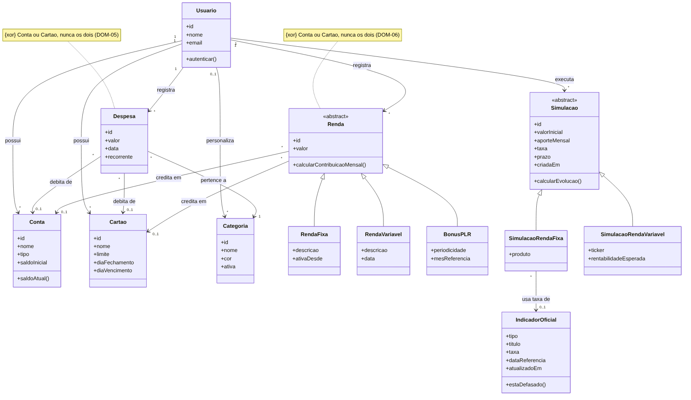
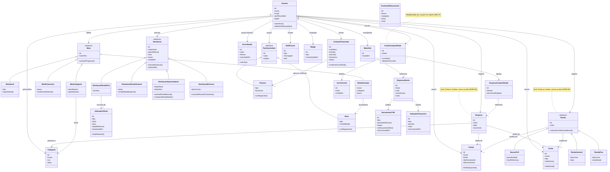

# Modelo de Domínio — FinNova

- **Versão:** V1 (recorte Must have) + modelo completo de referência
- **Última atualização:** 2026-10-18

> Ciclo completo: (1) termos de domínio extraídos dos RF/RB, (2) classes candidatas e responsabilidades, (3) diagrama de classes do domínio V1, (4) relações e multiplicidades em texto, com cláusulas EARS, (5) modelo completo, (6) rastreabilidade requisito → issue → classe → teste, (7) elementos que ficam fora do domínio e (8) questões em aberto.
>
> Referência completa dos requisitos: `/docs/03-requisitos/requisitos.md`. Este documento cobre o **modelo de domínio (conceitual/OO)** — não deve ser confundido com o modelo de dados relacional da seção 4 de `requisitos.md`, que é o modelo de persistência (tabelas). Aqui, `Renda`, `Meta`, `Simulacao` e `PatrimonioItem` aparecem como hierarquias (generalização/especialização) para expressar comportamento comum entre subtipos — uma decisão de modelagem OO que a tabela relacional não precisa refletir 1:1.
>
> **Fonte e vista:** a fonte do modelo é este texto e os arquivos Mermaid em `/docs/uml/` (`dominio-v1.mmd` e `dominio-completo.mmd`). Os PNGs são apenas a vista exportada. Os termos usados aqui fazem parte do vocabulário obrigatório do glossário (`requisitos.md`, seção 8.1).

---

## 1. Termos de domínio extraídos das stories/RF

Revisão de `requisitos.md` (RF-01 a RF-67) destacando os substantivos que representam conceitos do negócio:

| Módulo | Termos de domínio identificados |
|---|---|
| Conta e Acesso | Usuário, Perfil de investidor, Papel (usuário/administrador) |
| Administração Financeira | Conta, Cartão, Categoria, Renda fixa, Renda variável, Bônus/PLR, Despesa, Meta geral, Meta por categoria |
| Simulador de Investimentos | Simulação, Meta financeira, Indicador oficial (Selic/CDI/IPCA/Tesouro Direto), Cotação |
| Relatórios de Empresas | Empresa aberta, Documento CVM, Indicador financeiro, Watchlist |
| Patrimônio | Ativo, Passivo, Patrimônio líquido, Meta nomeada |
| Score de Saúde Financeira | Score de saúde, Fator de ponderação, Benchmark |
| Conteúdo Educacional | Conteúdo educacional, Termo |
| Compras Financiadas | Compra financiada, Parcela, Amortização |
| Recursos transversais | Notificação |
| Painel Administrativo | Administrador |
| Contas Compartilhadas | Conta compartilhada, Despesa compartilhada, Acerto de contas |
| Aposentadoria/Previdência/Impostos | Simulação de aposentadoria, PGBL, VGBL, Estimativa de IR, Informe de rendimentos |
| Gamificação | Badge/Conquista |

**Termos descartados por serem técnicos ou genéricos** (não viram classe do domínio; ver seção 7): Exportação, Webhook, Evento de uso, Log de auditoria, Dashboard de uso.

---

## 2. Classes candidatas e responsabilidades

| Classe | Responsabilidade principal | RF/RB de origem |
|---|---|---|
| `Usuario` | Autenticar-se, manter o perfil de investidor e o papel, e ser o agregador raiz de todos os dados financeiros pessoais | RF-01, RF-02, RF-03 |
| `Conta` | Representar uma conta bancária/carteira e expor o saldo atual | RF-12 |
| `Cartao` | Controlar limite e ciclo de fatura; calcular limite disponível (RB-04) | RF-12, RF-13 |
| `Categoria` | Classificar despesas em áreas de gasto: padrão (sem dono, comum a todos) ou personalizada (de um usuário) | RF-10 |
| `Renda` (abstrata) | Generalizar o comportamento comum de qualquer entrada de renda; calcular contribuição mensal | RF-06, RF-07, RF-08 |
| `RendaFixa` / `RendaVariavel` / `BonusPLR` | Especializações de `Renda`, cada uma com sua regra de cálculo (RB-05, RB-06) | RF-06, RF-07, RF-08 |
| `Despesa` | Representar um gasto, opcionalmente recorrente ou compartilhado | RF-09, RF-11 |
| `Meta` (abstrata) | Generalizar metas do usuário; calcular progresso | RF-14, RF-15 |
| `MetaGeral` / `MetaCategoria` / `MetaFinanceira` / `MetaNomeada` | Especializações de `Meta` por escopo (renda/gasto geral, categoria, projeção de investimento, objetivo nomeado vinculado a um ativo) | RF-14, RF-15, RF-26, RF-40 |
| `Simulacao` (abstrata) | Guardar os parâmetros de uma simulação (valor inicial, aporte, taxa, prazo) e calcular a evolução por juros compostos (`calcularEvolucao()`, RB-10) e a estimativa de IR (`estimarIR()`, RB-25) | RF-20, RF-22, RF-25, RF-64 |
| `SimulacaoRendaFixa` | Simular CDB, Tesouro ou poupança com a taxa do indicador oficial ou uma taxa manual (RB-07) | RF-20, RF-23 |
| `SimulacaoRendaVariavel` | Projetar a evolução de ações/FIIs a partir de rentabilidade esperada, sempre como estimativa (RB-08) | RF-21 |
| `SimulacaoAposentadoria` | Projetar o patrimônio na idade-alvo, estimar a renda mensal e comparar PGBL, VGBL e carteira própria | RF-62, RF-63 |
| `SimulacaoEstresse` | Calcular por quantos meses o patrimônio cobre um cenário de choque, sem alterar dados reais (RB-17) | RF-39 |
| `IndicadorOficial` | Guardar a taxa oficial (Selic, CDI, IPCA ou título do Tesouro Direto) com data de referência e indicar se está defasada (RNF-09) | RF-23 |
| `EmpresaAberta` | Representar uma companhia listada em bolsa | RF-29 |
| `DocumentoCVM` | Guardar metadados de um documento oficial e o link externo (nunca o binário) | RF-30, RF-31, RB-12 |
| `IndicadorFinanceiro` | Guardar um indicador estruturado de uma empresa, extraído dos dados abertos da CVM (não confundir com `IndicadorOficial`) | RF-32 |
| `Watchlist` | Vincular um usuário a empresas de interesse | RF-34 |
| `PatrimonioItem` (abstrata) | Generalizar itens que compõem o patrimônio, com valor e origem (automática/manual) | RF-35 |
| `Ativo` / `Passivo` | Especializações de `PatrimonioItem`; calculam a cor do mapa de calor patrimonial (RB-14) | RF-35, RF-37 |
| `ScoreSaude` | Calcular a nota de saúde financeira e manter o histórico mensal | RF-41, RF-42 |
| `CompraFinanciada` | Simular um financiamento e, ao ser confirmada, gerar um `Passivo` (RB-16) | RF-45 a RF-47 |
| `Notificacao` | Representar um alerta ao usuário (o envio pelo canal é responsabilidade técnica, seção 7) | RF-48, RF-49 |
| `ConteudoEducacional` | Fornecer verbetes explicativos e ajuda contextual | RF-43, RF-44 |
| `ContaCompartilhada` | Vincular dois usuários e controlar o ciclo de vida do vínculo | RF-60 |
| `DespesaCompartilhada` | Registrar a divisão de uma `Despesa` entre os dois usuários vinculados | RF-61, RB-24 |
| `AcertoConta` | Registrar um pagamento entre os dois usuários que reduz o saldo pendente | RF-61, RB-24 |
| `Badge` | Representar uma conquista obtida pelo usuário | RF-67 |

> **Nota de design — `Simulacao`:** a classe deixou de concentrar todos os tipos de cálculo e passou a ser abstrata, com uma especialização por tipo. `Simulacao` é uma **entidade** (tem identidade e é guardada para a comparação do RF-25). O "motor de juros compostos" da SPEC-002 e do ADR-002 é a **implementação** pura da operação `calcularEvolucao()`, uma decisão técnica e não um conceito do negócio; por isso não aparece no diagrama.
>
> **Nota de design — comparação de cenários (RF-25):** não é classe, porque não tem identidade própria (regra prática: conceito do negócio + identidade + regras). É uma operação sobre duas ou mais `Simulacao` do mesmo usuário (cláusula DOM-10).

---

## 3. Diagrama de classes do domínio V1 (recorte Must have)

Recorte atual do MVP: RF-01, RF-02, RF-06 a RF-12, RF-20 a RF-23 e RF-25.



Fonte editável (Mermaid): `uml/dominio-v1.mmd`. Para regenerar a imagem após editar o `.mmd`, a partir de `/docs/uml/`:

```bash
mmdc -i dominio-v1.mmd -o dominio-v1.png -b white --scale 2
```

---

## 4. Relações e multiplicidades do V1 (texto)

Leitura nos dois sentidos, sempre começando por "1": "1 *conceito* pode ter quantos *papel*?".

| ID | Relação | Leitura nos dois sentidos | Origem |
|---|---|---|---|
| DOM-01 | `Usuario` — `Conta` / `Cartao` | Um `Usuario` possui de 0 a N `Contas` e de 0 a N `Cartoes`; cada `Conta` e cada `Cartao` pertence a exatamente 1 `Usuario`. | RF-12 |
| DOM-02 | `Usuario` — `Categoria` | Um `Usuario` personaliza de 0 a N `Categorias`; cada `Categoria` pertence a no máximo 1 `Usuario` (categorias padrão não têm dono). | RF-10 |
| DOM-03 | `Usuario` — `Renda` / `Despesa` | Um `Usuario` registra de 0 a N `Rendas` e de 0 a N `Despesas`; cada lançamento pertence a exatamente 1 `Usuario`. | RF-06 a RF-09 |
| DOM-04 | `Despesa` — `Categoria` | Cada `Despesa` pertence a exatamente 1 `Categoria`; uma `Categoria` classifica de 0 a N `Despesas`. | RB-02 |
| DOM-05 | `Despesa` — `Conta` / `Cartao` | Cada `Despesa` debita de no máximo 1 `Conta` ou de no máximo 1 `Cartao`, nunca dos dois; uma `Conta` ou um `Cartao` recebe de 0 a N `Despesas`. | RF-12 |
| DOM-06 | `Renda` — `Conta` / `Cartao` | Cada `Renda` credita em no máximo 1 `Conta` ou em no máximo 1 `Cartao`, nunca nos dois; uma `Conta` ou um `Cartao` recebe de 0 a N `Rendas`. | RF-12 |
| DOM-07 | `Renda` — subtipos | Toda `Renda` é exatamente uma de: `RendaFixa`, `RendaVariavel` ou `BonusPLR` (generalização). | RF-06 a RF-08 |
| DOM-08 | `Usuario` — `Simulacao` | Um `Usuario` executa de 0 a N `Simulacoes`; cada `Simulacao` pertence a exatamente 1 `Usuario`. Toda `Simulacao` é `SimulacaoRendaFixa` ou `SimulacaoRendaVariavel` no V1. | RF-20, RF-21 |
| DOM-09 | `SimulacaoRendaFixa` — `IndicadorOficial` | Cada `SimulacaoRendaFixa` usa a taxa de no máximo 1 `IndicadorOficial` (nenhum quando o usuário informa taxa manual); um `IndicadorOficial` alimenta de 0 a N simulações. | RF-20, RF-23 |
| DOM-10 | Comparação de cenários | Uma comparação envolve 2 ou mais `Simulacoes` do mesmo `Usuario`. | RF-25 |

### 4.1 Cláusulas EARS de multiplicidade

| ID | Tipo EARS | Cláusula |
|---|---|---|
| DOM-01 | Ubiquitous | THE SYSTEM SHALL associar cada `Conta` e cada `Cartao` a exatamente um `Usuario`. |
| DOM-02 | Ubiquitous | THE SYSTEM SHALL disponibilizar as categorias padrão a todos os usuários e cada categoria personalizada apenas ao `Usuario` que a criou. |
| DOM-03 | Ubiquitous | THE SYSTEM SHALL associar cada `Renda` e cada `Despesa` a exatamente um `Usuario`. |
| DOM-04 | Unwanted behavior | IF uma despesa for registrada sem categoria THEN THE SYSTEM SHALL rejeitar o registro. |
| DOM-05 | Unwanted behavior | IF uma despesa for vinculada a uma conta e a um cartão ao mesmo tempo THEN THE SYSTEM SHALL rejeitar o vínculo. |
| DOM-06 | Unwanted behavior | IF uma renda for vinculada a uma conta e a um cartão ao mesmo tempo THEN THE SYSTEM SHALL rejeitar o vínculo. |
| DOM-07 | Ubiquitous | THE SYSTEM SHALL classificar cada renda como exatamente um dos tipos: renda fixa, renda variável ou bônus/PLR. |
| DOM-08 | Ubiquitous | THE SYSTEM SHALL associar cada `Simulacao` a exatamente um `Usuario`. |
| DOM-09 | Event-driven | WHEN uma simulação de renda fixa for criada sem taxa manual THE SYSTEM SHALL associá-la ao `IndicadorOficial` correspondente ao produto. |
| DOM-10 | Unwanted behavior | IF o usuário selecionar menos de duas simulações para comparação THEN THE SYSTEM SHALL impedir a comparação. |

Cada cláusula vira ao menos um teste na spec do RF de origem (ver seção 6).

---

## 5. Modelo completo (referência)

Visão de todos os módulos, para contexto. O trabalho da fase atual segue o V1 (seção 3).



Fonte editável (Mermaid): `uml/dominio-completo.mmd`. Para regenerar, a partir de `/docs/uml/`:

```bash
mmdc -i dominio-completo.mmd -o dominio-completo.png -b white -w 2200 -H 2400 --scale 2
```

### Principais relações do modelo completo

- `Usuario` é o agregador raiz: possui contas, cartões, categorias personalizadas, rendas, despesas, metas, simulações, itens de patrimônio, histórico de score, compras financiadas, notificações e badges. As associações são de posse; as responsabilidades de `Usuario` continuam restritas a identidade e perfil.
- `Renda`, `Meta`, `Simulacao` e `PatrimonioItem` são classes abstratas com especializações (generalização/herança), reduzindo duplicação de regra entre subtipos.
- `Despesa` e `Renda` podem ser vinculadas a uma `Conta` ou a um `Cartao` (nunca aos dois); `Despesa` pertence a uma `Categoria` e pode ser referenciada por uma `DespesaCompartilhada`.
- `SimulacaoRendaFixa` usa a taxa de um `IndicadorOficial`, salvo quando o usuário informa taxa manual.
- `ContaCompartilhada` vincula exatamente 2 `Usuario`, agrupa `DespesaCompartilhada` e registra `AcertoConta` (RF-60/61). A multiplicidade por usuário está em aberto (RB-27).
- `CompraFinanciada`, ao ser confirmada como real, gera um `Passivo` (RB-16).
- `EmpresaAberta` publica `DocumentoCVM` e reporta `IndicadorFinanceiro`; `Watchlist` liga `Usuario` a `EmpresaAberta`.

---

## 6. Rastreabilidade requisito → issue → classe → teste

### 6.1 Recorte V1 (Must have)

| Requisito | Issue | Classes do domínio | Cláusulas que viram teste |
|---|---|---|---|
| RF-01 | [#9](https://github.com/EricToshioGoya/Finance-management/issues/9) | `Usuario` | SPEC-001-R01, R02, R03, R06, R08 |
| RF-02 | [#10](https://github.com/EricToshioGoya/Finance-management/issues/10) | `Usuario` | SPEC-001-R04, R05, R07, R08, R09 |
| RF-06 | [#11](https://github.com/EricToshioGoya/Finance-management/issues/11) | `Renda`, `RendaFixa`, `Conta`, `Cartao` | DOM-03, DOM-06, DOM-07; RB-01, RB-05 (spec a criar) |
| RF-07 | [#12](https://github.com/EricToshioGoya/Finance-management/issues/12) | `Renda`, `RendaVariavel`, `Conta`, `Cartao` | DOM-03, DOM-06, DOM-07; RB-01, RB-05 (spec a criar) |
| RF-08 | [#13](https://github.com/EricToshioGoya/Finance-management/issues/13) | `Renda`, `BonusPLR` | DOM-03, DOM-07; RB-05, RB-06 (spec a criar) |
| RF-09 | [#14](https://github.com/EricToshioGoya/Finance-management/issues/14) | `Despesa`, `Categoria`, `Conta`, `Cartao` | DOM-03, DOM-04, DOM-05; RB-01, RB-02 (spec a criar) |
| RF-10 | [#15](https://github.com/EricToshioGoya/Finance-management/issues/15) | `Categoria`, `Usuario` | DOM-02, DOM-04 (spec a criar) |
| RF-11 | [#16](https://github.com/EricToshioGoya/Finance-management/issues/16) | `Renda`, `Despesa` | Spec a criar |
| RF-12 | [#17](https://github.com/EricToshioGoya/Finance-management/issues/17) | `Conta`, `Cartao`, `Renda`, `Despesa` | DOM-01, DOM-05, DOM-06 (spec a criar) |
| RF-20 | [#18](https://github.com/EricToshioGoya/Finance-management/issues/18) | `Simulacao`, `SimulacaoRendaFixa`, `IndicadorOficial` | SPEC-002-R01 a R07; DOM-08, DOM-09; RB-07 |
| RF-21 | [#19](https://github.com/EricToshioGoya/Finance-management/issues/19) | `Simulacao`, `SimulacaoRendaVariavel` | DOM-08; RB-08 (spec a criar) |
| RF-22 | [#20](https://github.com/EricToshioGoya/Finance-management/issues/20) | `Simulacao` (`calcularEvolucao()`) | SPEC-002-R01 a R07; RB-10 |
| RF-23 | [#21](https://github.com/EricToshioGoya/Finance-management/issues/21) | `IndicadorOficial` | DOM-09 (spec a criar) |
| RF-25 | [#22](https://github.com/EricToshioGoya/Finance-management/issues/22) | `Simulacao` | DOM-10 (spec a criar) |

### 6.2 Modelo completo

| Classe | RFs relacionados | RBs relacionadas |
|---|---|---|
| Usuario | RF-01, RF-02, RF-03, RF-04, RF-05 | RB-09 |
| Conta / Cartao | RF-12, RF-13 | RB-04 |
| Categoria | RF-10 | RB-02 |
| Renda / RendaFixa / RendaVariavel / BonusPLR | RF-06, RF-07, RF-08, RF-12 | RB-01, RB-05, RB-06 |
| Despesa | RF-09, RF-11, RF-12 | RB-01, RB-02 |
| Meta / MetaGeral / MetaCategoria / MetaFinanceira / MetaNomeada | RF-14, RF-15, RF-19, RF-26, RF-40 | RB-18 |
| Simulacao / SimulacaoRendaFixa / SimulacaoRendaVariavel / SimulacaoAposentadoria / SimulacaoEstresse | RF-20 a RF-28, RF-39, RF-62, RF-63, RF-64 | RB-07, RB-08, RB-10, RB-17, RB-25 |
| IndicadorOficial | RF-20, RF-23 | — (RNF-09) |
| EmpresaAberta / DocumentoCVM / IndicadorFinanceiro / Watchlist | RF-29 a RF-34 | RB-12 |
| PatrimonioItem / Ativo / Passivo | RF-35, RF-36, RF-37, RF-38 | RB-13, RB-14 |
| ScoreSaude | RF-41, RF-42, RF-66 | RB-15, RB-26 |
| CompraFinanciada | RF-45, RF-46, RF-47 | RB-16 |
| Notificacao | RF-48, RF-49 | — |
| ConteudoEducacional | RF-43, RF-44 | — |
| ContaCompartilhada / DespesaCompartilhada / AcertoConta | RF-60, RF-61 | RB-24 |
| Badge | RF-67 | — |

---

## 7. Elementos fora do modelo de domínio

Representam decisões técnicas, não conceitos do negócio. Continuam no modelo de dados (`requisitos.md`, seção 4) e na arquitetura (`/docs/07-arquitetura/arquitetura.md`).

| Elemento | Natureza | Requisitos |
|---|---|---|
| `senhaHash` (atributo de usuário) | Segurança de credenciais | RF-01, RNF-01, SPEC-001 |
| `idioma` e `tema` (atributos de usuário) | Preferências de interface | RNF-19, RNF-20 |
| `WebhookSubscription` | Integração com sistemas externos | RF-52, RF-53, RNF-23 |
| `AuditLog` | Trilha de auditoria imutável | RF-54, RNF-18, RNF-21 |
| `EventoUso` | Telemetria agregada para o painel administrativo | RF-59, RB-22, RB-23 |
| Envio de notificação (push/e-mail) | Canal de entrega | RF-49 |

---

## 8. Questões em aberto

Dúvidas de regra registradas como issues RB, com o impacto previsto no diagrama.

| ID | Dúvida | Classes afetadas | Issue |
|---|---|---|---|
| RB-27 | Quantas contas compartilhadas um usuário pode ter? | `Usuario`, `ContaCompartilhada` | [#25](https://github.com/EricToshioGoya/Finance-management/issues/25) |
| RB-28 | A despesa recorrente é um registro único ou uma instância por mês? | `Despesa` (V1) | [#26](https://github.com/EricToshioGoya/Finance-management/issues/26) |
| RB-29 | Alterar a renda fixa afeta os meses anteriores? | `Renda`, `RendaFixa` (V1) | [#27](https://github.com/EricToshioGoya/Finance-management/issues/27) |
